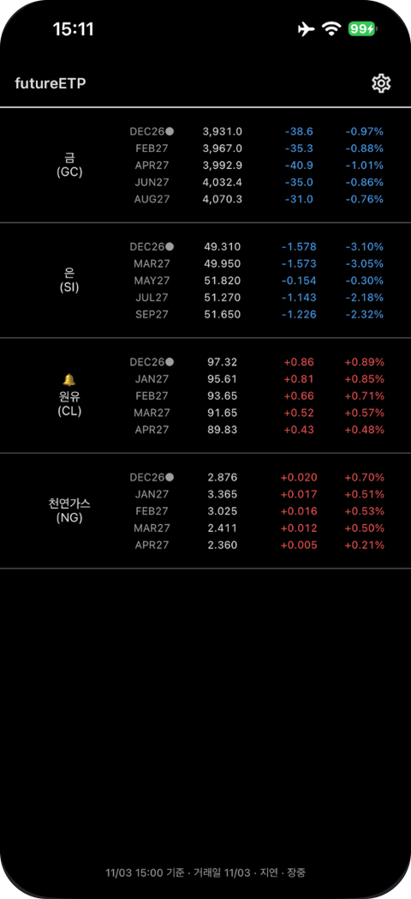
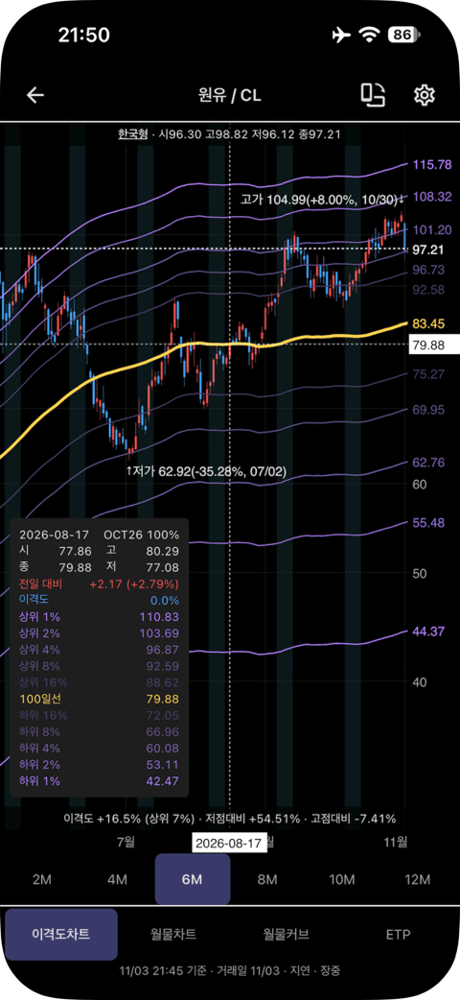
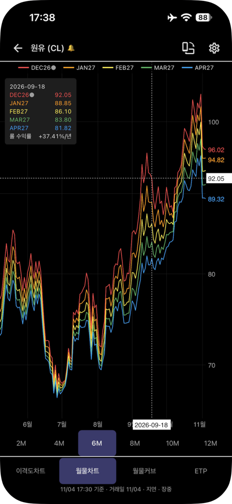
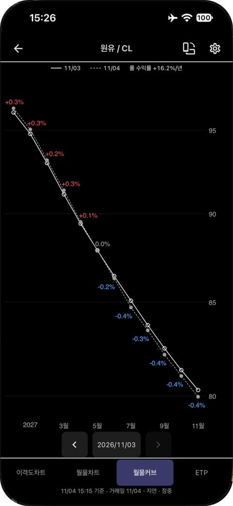
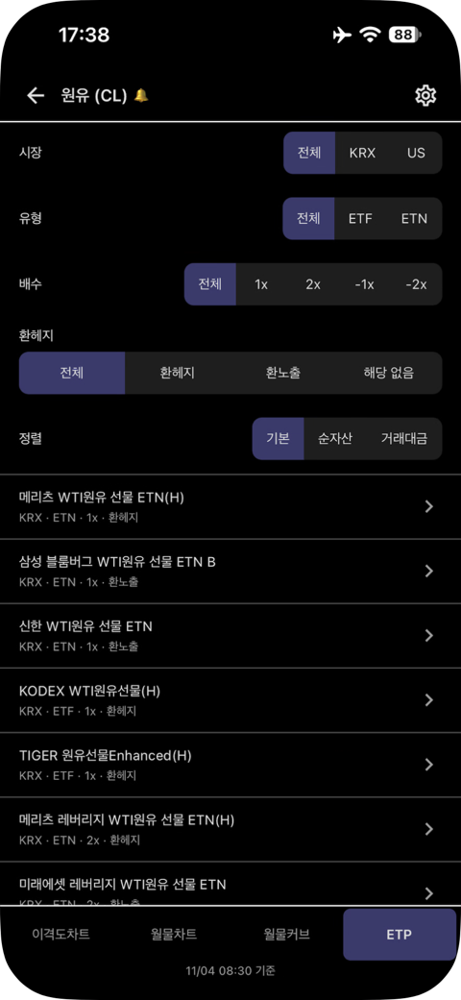
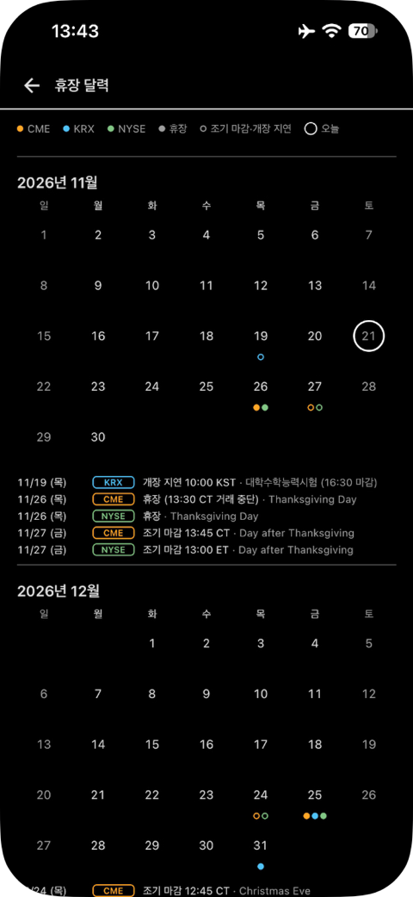
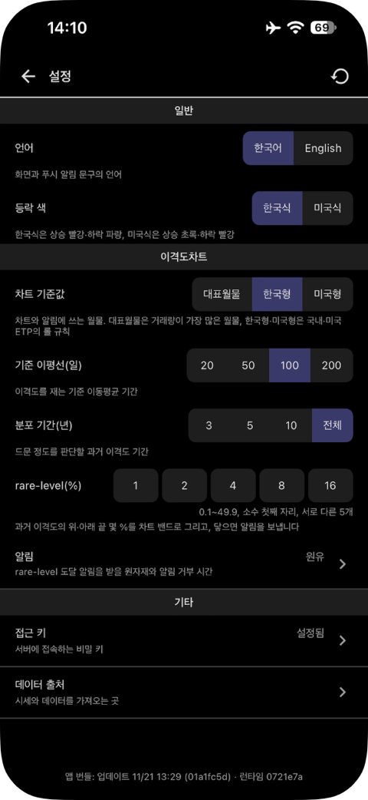
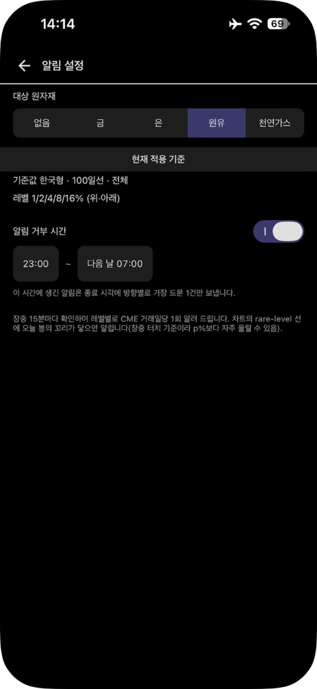
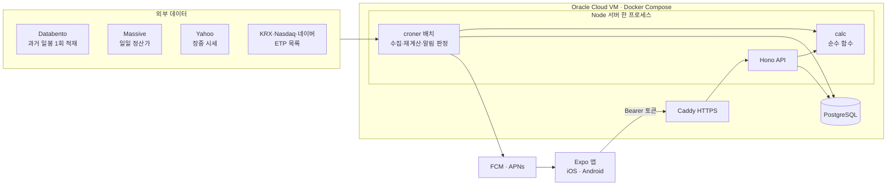

# futureETP

원자재 선물 기반 ETP(ETF/ETN)에 투자할 때 필요한데 기존 시세 서비스에는 없는 정보를 보여 주는 개인용 모바일 앱입니다.
iOS·Android, 사용자 본인 1명용(스토어 미배포)으로 1인 풀스택 개발했습니다.

<table>
  <tr>
    <th>원자재 목록</th>
    <th>이격도차트</th>
    <th>월물차트</th>
    <th>월물커브</th>
  </tr>
  <tr>
    <td></td>
    <td></td>
    <td></td>
    <td></td>
  </tr>
  <tr>
    <th>ETP 목록</th>
    <th>휴장 달력</th>
    <th>설정</th>
    <th>알림 설정</th>
  </tr>
  <tr>
    <td></td>
    <td></td>
    <td></td>
    <td></td>
  </tr>
</table>

## 왜 만들었나

원유·천연가스·금·은 ETP는 실물이 아니라 선물을 보유하고, 상품마다 정해진 규칙으로 월물을 롤오버합니다.
그런데 인베스팅·트레이딩뷰 같은 서비스는 자기 기준의 "대표 월물" 시세만 보여 줍니다.
그래서 내가 산 ETP가 실제로 따라가는 가격 흐름, 롤오버 비용, 지금 가격이 역사적으로 얼마나 드문 구간인지 알기 어렵습니다.

## 주요 기능

- **이격도차트**: ETP 롤 규칙(S&P GSCI·BCOM·BCBCLI 일정)으로 월물을 혼합한 수익률 연결 지수를 봉차트로 그리고 롤 구간을 표시합니다. 이동평균선, 이격도의 역사적 분포에서 계산한 rare 레벨 밴드, 고점·저점 대비 등락을 함께 보여 줍니다.
- **월물커브**: 기준일과 그다음 거래일의 커브를 겹쳐 하루 동안의 월물별 변화율, 콘탱고/백워데이션, 연 환산 롤 수익률을 보여 줍니다(2010년 이후 아무 날이나 기준일로 선택).
- **월물차트·ETP 목록**: 월물별 가격 비교와 양끝 월물의 연 환산 롤 수익률, 해당 원자재를 추종하는 국내(KRX)·미국 ETP의 롤 규칙·배수·보수·거래대금을 보여 줍니다.
- **휴장 달력**: CME와 ETP가 상장된 KRX·NYSE의 휴장·조기 마감·개장 지연 일정을 이번 달부터 3개월간 한 달력에 시장별 색 점으로 보여 줍니다.
- **알림**: 가격이 rare 레벨에 도달하면 푸시 알림(FCM·APNs)을 보냅니다. 알림 원자재·기준·거부 시간은 기기마다 따로 저장합니다.
- 한국어·영어 UI, 다크 테마, 가로 모드 차트, 핀치 줌·십자선 제스처를 지원합니다.

대상 원자재는 금(GC)·은(SI)·WTI 원유(CL)·천연가스(NG)입니다.

## 아키텍처



- **모노레포(npm workspaces)**: `apps/mobile`(Expo 앱), `apps/server`(API + 배치), `packages/shared`(zod 스키마·타입). 앱과 서버는 서로 import하지 않고 shared만 의존합니다.
- **계산은 서버에만**: 지수·롤 비중·이평선·이격도 분포·커브 계산은 `apps/server/src/calc`의 순수 함수로 두고 단위 테스트합니다. 배치가 미리 계산해 저장하고, 조회 API는 저장값을 읽기만 합니다.
- **API 계약 공유**: 응답은 `{ success, data | error }` 봉투 하나로 통일하고, 앱은 서버와 같은 shared zod 스키마로 응답을 검증합니다.
- **앱 레이어**: route → 화면(`features/`) → TanStack Query hook → `api/` 순서로만 호출합니다. 하위 레이어가 상위를, feature끼리 서로 import하지 못하도록 ESLint로 막습니다. 차트는 Skia로 직접 그린 레이어를 조합합니다.
- **다른 클라이언트**: 같은 서버를 쓰는 Flutter·SwiftUI·Kotlin 앱을 형제 저장소로 만들고 있습니다. 이 저장소가 문서와 계약의 원본이고, shared zod 스키마를 `packages/shared/contract/`의 JSON Schema 파일로 내보내(`npm run contract:export`) 다른 언어 앱이 읽습니다. 커밋된 파일이 스키마와 어긋나면 테스트가 실패합니다.

## 기술 스택

| 영역 | 사용 기술 |
|---|---|
| 공통 | TypeScript (strict), Node 26, npm workspaces |
| App | Expo SDK 58 (React Native 0.88, React 19), Expo Router, TanStack Query, Zustand, Victory Native XL + Skia, Reanimated, i18next |
| Server | Hono, zod, Drizzle ORM, croner (Node 타입 스트리핑으로 빌드 없이 실행) |
| DB | PostgreSQL 18 |
| Infra | Oracle Cloud Always Free ARM VM, Docker Compose, Caddy, Healthchecks.io, EAS Update(앱 OTA) |
| Test/Lint | Vitest, fast-check(속성 기반 테스트), jest-expo + React Native Testing Library, Stryker(변이 검사, 수시 측정), ESLint, knip, Prettier, husky |

## 개발 방식

- 기능을 만들기 전에 기획 → 리서치 → 데이터 모델 → 기술 스택 → 아키텍처 순으로 문서를 먼저 확정했습니다.
- 설계 결정 140여 건을 근거·대안과 함께 [`docs/decisions.md`](docs/decisions.md)(D-001~)에 기록했습니다.
- 커밋 전 `npm run check`(타입 검사·lint·미사용 코드(knip)·마이그레이션 drift·포맷·전체 테스트와 서버·shared 커버리지 하한)를 통과해야 합니다. push마다 CI가 같은 검사와 arm64 서버 이미지 빌드·기동을 확인합니다.

| 문서 | 내용 |
|---|---|
| [`docs/product.md`](docs/product.md) | 서비스 기획, 용어, 계산 정의, 외부 연동 |
| [`docs/wireframes/screens.md`](docs/wireframes/screens.md) | 화면 와이어프레임과 화면별 동작 |
| [`docs/architecture.md`](docs/architecture.md) | 디렉터리 구조, 레이어, API·에러 규약, 환경 분리 |
| [`docs/data-model.md`](docs/data-model.md) | DB 논리 모델 (ERD) |
| [`docs/tech-stack.md`](docs/tech-stack.md) | 기술 스택과 버전 |
| [`docs/research/`](docs/research/) | 시세 소스 비교, 비용, ETP 롤 규칙 조사 |
| [`docs/reviews/`](docs/reviews/) | 전체 코드 품질 검증 보고서 (리뷰·교차 검증·변이 점수) |

## 품질 검증과 테스트

테스트는 서버 896개, 앱 404개, shared 28개입니다. 계층마다 무엇을 막으려는지 정해 두고 검사합니다.

| 계층 | 방법 | 기대 효과 |
|---|---|---|
| 계산(calc) | 순수 함수 단위 테스트, 커버리지 하한 lines·functions 100%·branches 90%. 롤 비중·지수 체인·이격도·장 상태·알림 판정·월물 기호 6개 모듈은 fast-check 속성 기반 테스트 | 지수·롤 수익률 계산 오류가 차트와 알림으로 새지 않습니다. 사람이 떠올리지 못한 경계값도 무작위 입력으로 불변식을 확인합니다 |
| 서버 API·DB | 라우트 테스트와 실제 PostgreSQL 18에 붙는 DB 통합 테스트, 서버 전체 커버리지 하한 80% | 응답 봉투·에러 code·HTTP 상태 계약을 고정하고, SQL·마이그레이션 오류를 배포 전에 찾습니다 |
| API 계약 | 앱·서버가 같은 shared zod 스키마를 쓰고, 내보낸 JSON Schema 파일이 스키마와 어긋나면 테스트가 실패 | 서버 변경이 RN·Flutter·SwiftUI·Kotlin 앱을 조용히 깨뜨리지 않습니다 |
| 앱 | jest-expo + RNTL로 화면·hook, 차트 뷰포트(핀치·이동·십자선)와 순수 로직 테스트 | 제스처·십자선·설정 저장처럼 기기에서만 드러나던 상태 버그의 회귀를 막습니다 |
| 정적 검사 | TypeScript strict(`noUncheckedIndexedAccess`, 서버·shared는 `exactOptionalPropertyTypes`까지), ESLint 레이어·feature 간 import 금지, knip, 마이그레이션 drift | 타입 구멍·의존 방향 위반·죽은 코드·스키마와 마이그레이션 불일치를 실행 전에 막습니다 |

커밋 전에 `npm run check`가 위 검사를 모두 돌리고, push마다 CI(GitHub Actions)가 같은 검사에 arm64 서버 이미지 빌드·기동 확인, 의존성 audit, 미뤄 둔 업그레이드 조건 주간 확인을 더합니다.

### 전체 코드 품질 검증 (2026-11-21)

영역 5개(calc, API·DB, 배치·외부 소스, shared·계약, 모바일)를 리뷰하고, 각 발견을 다른 agent가 반박하는 쪽에서 재현해 걸러 낸 뒤, Stryker 변이 검사로 테스트 자체의 품질을 쟀습니다. 상세는 [보고서](docs/reviews/2026-11-21-quality-review.md)에 있습니다.

| 지표 | 서버 | shared | 앱 |
|---|---|---|---|
| 라인 커버리지 (현재) | 85% | 98% | 78% |
| 변이 점수 | 90.5% (calc+api, 검증 시점) | 89.1% (검증 시점) | 72.2% (차트·순수 로직, 보강 뒤. 검증 시점 65.2%) |

- **결함**: 확정 14건(important 2건), 반박 1건. important 2건과 영향이 큰 5건을 회귀 테스트와 함께 고쳤습니다. 휴장 전날 저녁 장중 배치 누락, 실패한 알림의 같은 슬롯 즉시 재발송, 데이터가 바뀐 뒤 십자선이 엉뚱한 봉을 가리킴, DB 유휴 연결이 끊기면 서버 프로세스 종료, 늦게 온 설정 조회가 방금 저장한 값을 덮어씀, 접근 키 재설정 뒤 푸시 재등록 누락, 월물커브 M2 판정 예외입니다.
- **테스트 보강**: 변이 점수가 낮던 곳을 골라 테스트를 더했습니다. `api/curve.ts` 66.7% → 93.0%, `clientIp.ts` 50.0% → 93.8%, 앱 `useChartViewport.ts` 6% → 85.4%이고, 남은 생존 변이는 대부분 결과가 같은 등가 변이입니다.
- **기대 효과**: 커버리지는 코드가 실행됐는지만 보고, 변이 점수는 코드가 틀렸을 때 테스트가 잡는지를 봅니다. 커버리지로는 안 보이는 약한 테스트를 수치로 찾아 보강할 곳을 정할 수 있습니다.

## 로컬 실행

필요: Node 26(`.nvmrc`), PostgreSQL 18, Android는 JDK 17·에뮬레이터, iOS는 Xcode.

```sh
npm install
cp apps/server/.env.example apps/server/.env   # DB 주소·외부 API 키 입력
npm run db:migrate -w apps/server
npm run dev -w apps/server                     # API 서버 (dev는 스케줄러 꺼짐)
npm run android:dev -w apps/mobile             # 또는 ios:dev
npm run check                                  # 타입 검사·lint·knip·포맷·테스트
```

시세 데이터는 각 업체의 개인용 요금제 약관에 따라 저장소에 포함하지 않습니다. 직접 실행하려면 각 소스의 API 키가 필요합니다.
