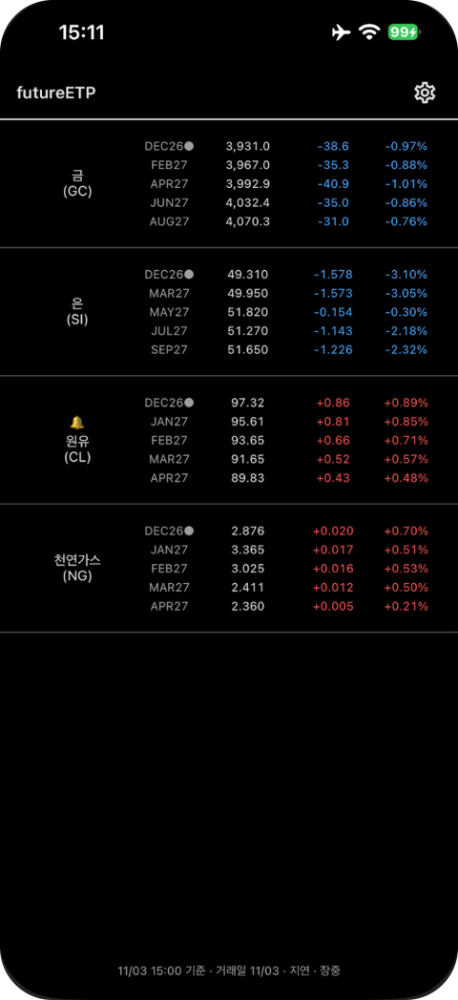
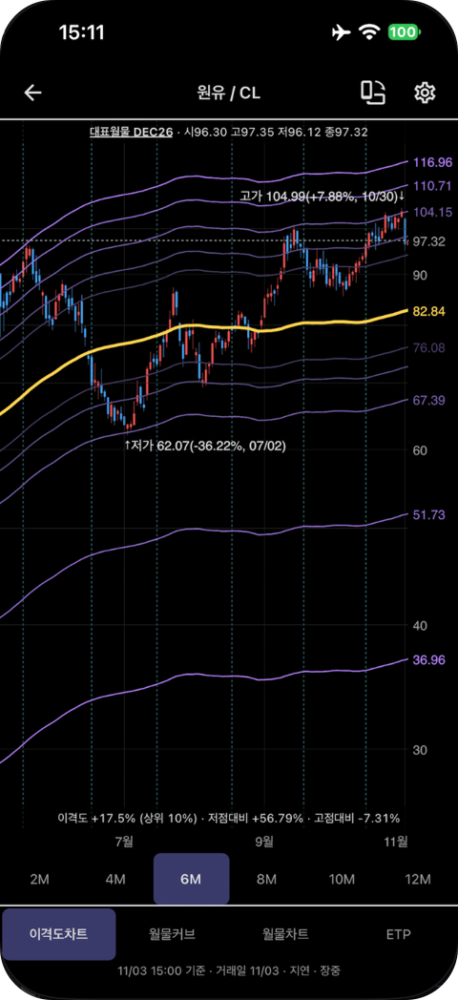
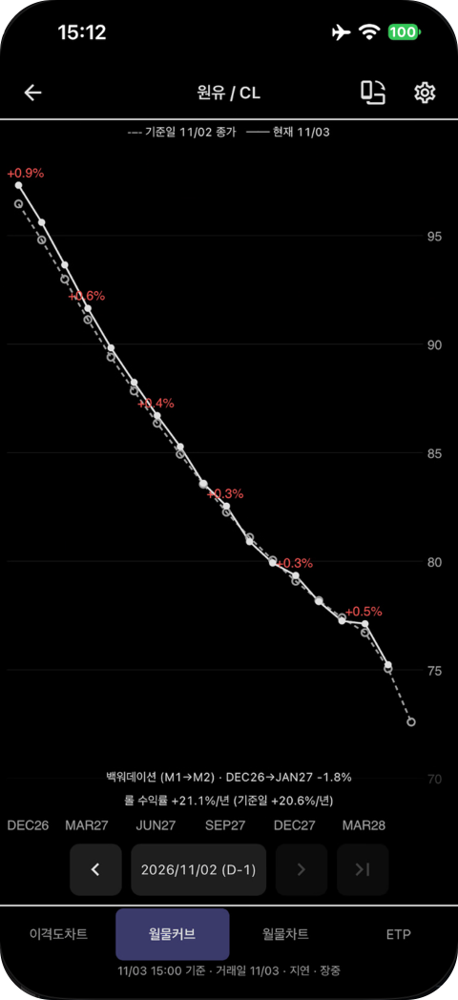
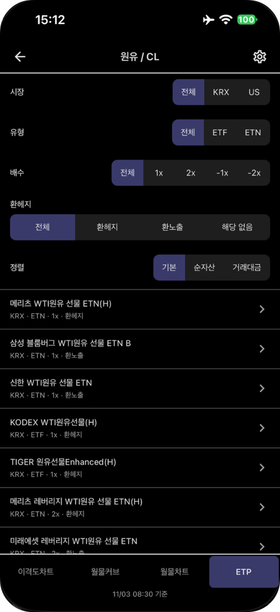
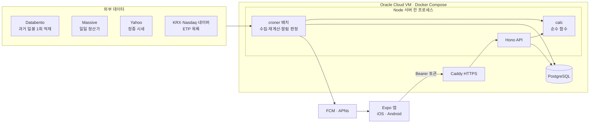

# futureETP

원자재 선물 기반 ETP(ETF/ETN)에 투자할 때 필요한데 기존 시세 서비스에는 없는 정보를 보여 주는 개인용 모바일 앱입니다.
iOS·Android, 사용자 본인 1명용(스토어 미배포)으로 1인 풀스택 개발했습니다.

| 원자재 목록 | 이격도차트 | 월물커브 | ETP 목록 |
|---|---|---|---|
|  |  |  |  |

## 왜 만들었나

원유·천연가스·금·은 ETP는 실물이 아니라 선물을 보유하고, 상품마다 정해진 규칙으로 월물을 롤오버합니다.
그런데 인베스팅·트레이딩뷰 같은 서비스는 자기 기준의 "대표 월물" 시세만 보여 줍니다.
그래서 내가 산 ETP가 실제로 따라가는 가격 흐름, 롤오버 비용, 지금 가격이 역사적으로 얼마나 드문 구간인지 알기 어렵습니다.

## 주요 기능

- **이격도차트**: ETP 롤 규칙(S&P GSCI·BCOM·BCBCLI 일정)으로 월물을 혼합한 수익률 연결 지수를 봉차트로 그리고 롤 구간을 표시합니다. 이동평균선, 이격도의 역사적 분포에서 계산한 rare 레벨 밴드, 고점·저점 대비 등락을 함께 보여 줍니다.
- **월물커브**: 기준일 대비 커브 변화, 콘탱고/백워데이션, 연 환산 롤 수익률을 보여 줍니다(2010년 이후 아무 날이나 기준일로 선택).
- **월물차트·ETP 목록**: 월물별 가격 비교, 해당 원자재를 추종하는 국내(KRX)·미국 ETP의 롤 규칙·배수·보수·거래대금을 보여 줍니다.
- **알림**: 가격이 rare 레벨에 도달하면 푸시 알림(FCM·APNs)을 보냅니다.
- 한국어·영어 UI, 다크 테마, 가로 모드 차트, 핀치 줌·십자선 제스처를 지원합니다.

대상 원자재는 금(GC)·은(SI)·WTI 원유(CL)·천연가스(NG)입니다.

## 아키텍처



- **모노레포(npm workspaces)**: `apps/mobile`(Expo 앱), `apps/server`(API + 배치), `packages/shared`(zod 스키마·타입). 앱과 서버는 서로 import하지 않고 shared만 의존합니다.
- **계산은 서버에만**: 지수·롤 비중·이평선·이격도 분포·커브 계산은 `apps/server/src/calc`의 순수 함수로 두고 단위 테스트합니다. 배치가 미리 계산해 저장하고, 조회 API는 저장값을 읽기만 합니다.
- **API 계약 공유**: 응답은 `{ success, data | error }` 봉투 하나로 통일하고, 앱은 서버와 같은 shared zod 스키마로 응답을 검증합니다.
- **앱 레이어**: route → 화면(`features/`) → TanStack Query hook → `api/` 순서로만 호출합니다. 차트는 Skia로 직접 그린 레이어를 조합합니다.

## 기술 스택

| 영역 | 사용 기술 |
|---|---|
| 공통 | TypeScript (strict), Node 26, npm workspaces |
| App | Expo SDK 58 (React Native 0.88, React 19), Expo Router, TanStack Query, Zustand, Victory Native XL + Skia, Reanimated, i18next |
| Server | Hono, zod, Drizzle ORM, croner (Node 타입 스트리핑으로 빌드 없이 실행) |
| DB | PostgreSQL 18 |
| Infra | Oracle Cloud Always Free ARM VM, Docker Compose, Caddy, Healthchecks.io |
| Test/Lint | Vitest, jest-expo + React Native Testing Library, ESLint, Prettier, husky |

## 개발 방식

- 기능을 만들기 전에 기획 → 리서치 → 데이터 모델 → 기술 스택 → 아키텍처 순으로 문서를 먼저 확정했습니다.
- 설계 결정 100여 건을 근거·대안과 함께 [`docs/decisions.md`](docs/decisions.md)(D-001~)에 기록했습니다.
- 커밋 전 `npm run check`(타입 검사·lint·포맷·전체 테스트)를 통과해야 합니다.

| 문서 | 내용 |
|---|---|
| [`docs/product.md`](docs/product.md) | 서비스 기획, 용어, 계산 정의, 외부 연동 |
| [`docs/wireframes/screens.md`](docs/wireframes/screens.md) | 화면 와이어프레임과 화면별 동작 |
| [`docs/architecture.md`](docs/architecture.md) | 디렉터리 구조, 레이어, API·에러 규약, 환경 분리 |
| [`docs/data-model.md`](docs/data-model.md) | DB 논리 모델 (ERD) |
| [`docs/tech-stack.md`](docs/tech-stack.md) | 기술 스택과 버전 |
| [`docs/research/`](docs/research/) | 시세 소스 비교, 비용, ETP 롤 규칙 조사 |

## 로컬 실행

필요: Node 26(`.nvmrc`), PostgreSQL 18, Android는 JDK 17·에뮬레이터, iOS는 Xcode.

```sh
npm install
cp apps/server/.env.example apps/server/.env   # DB 주소·외부 API 키 입력
npm run db:migrate -w apps/server
npm run dev -w apps/server                     # API 서버 (dev는 스케줄러 꺼짐)
npm run android:dev -w apps/mobile             # 또는 ios:dev
npm run check                                  # 타입 검사·lint·테스트
```

시세 데이터는 각 업체의 개인용 요금제 약관에 따라 저장소에 포함하지 않습니다. 직접 실행하려면 각 소스의 API 키가 필요합니다.
