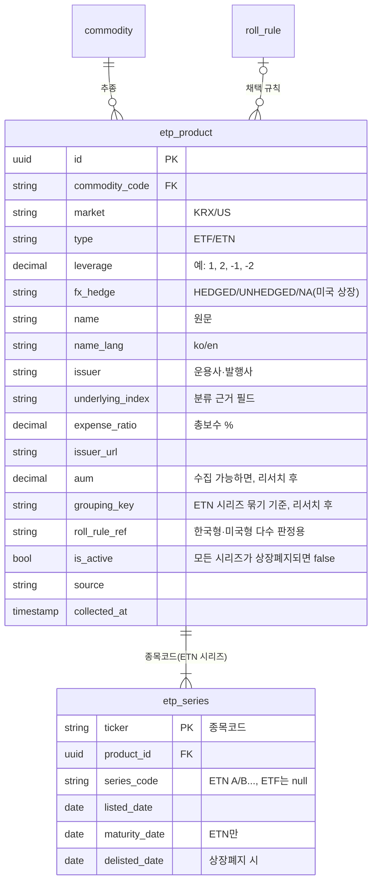
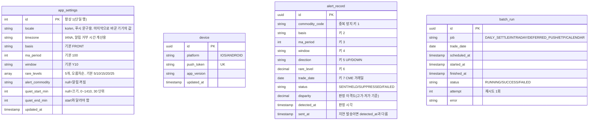

# 데이터 모델 초안

> TODO 1단계 Step 2 산출물. 서버 DB의 논리 모델이다. DB 종류와 물리 타입(배열·JSON 컬럼, 파티셔닝 등)은 TODO 2단계(Tech Stack)에서 정한다.
> 계산 규칙은 [`product.md`](product.md)가 기준이고, 여기서는 그 규칙을 담을 테이블만 정의한다. 결정 근거는 `decisions.md` D-010.

## 공통 규약
- 시각(`*_at`)은 UTC timestamp로 저장한다. 화면 표시는 기기 현지 시간으로 바꾼다.
- `trade_date`는 CME 거래일(date)이다. 달력 날짜가 아니다(17:00 CT에 바뀐다).
- 가격은 정밀 decimal로 저장한다(float 금지). 음수 가격을 허용한다(2020-04-20 WTI).
- enum 값
  - `commodity_code`: `GC` `SI` `CL` `NG`
  - `basis`(기준값): `FRONT`(대표월물) `KR`(한국형) `US`(미국형)
  - `ma_period`: 20 / 50 / 100 / 200
  - `window`(분포 기간 N): `Y3` `Y5` `Y10` `ALL`
  - `direction`: `UP` `DOWN`
- `rare_level`은 0.1~49.9의 decimal(3,1)이다.
- 자동 수집 데이터에는 `source`(수집 소스)와 `collected_at`을 둔다. 소스 이름은 리서치 후 정한다.

## 영역 구분
| 영역 | 테이블 | 갱신 주체 |
|---|---|---|
| 1. 시장 기준 데이터 | `commodity`, `contract`, `active_month_rule`, `trading_day` | 거래일 달력 배치, 일일 정산 배치(월물 상장) |
| 2. 시세 원천 | `daily_bar`, `intraday_snapshot` | 일일 정산 배치, 장중 배치 |
| 3. 계산 결과 | `roll_rule`, `roll_weight`, `index_bar`, `index_scale`, `disparity`, `disparity_distribution`, `index_snapshot` | 일일 정산 배치, 장중 배치 |
| 4. ETP | `etp_product`, `etp_series` | ETP 목록 배치 |
| 5. 설정·알림 | `app_settings`, `device`, `alert_record` | API, 장중 배치, 지연 발송 배치 |
| 6. 운영 | `batch_run` | 모든 배치 |

## 1~3. 시장 데이터와 계산 결과

```mermaid
erDiagram
    commodity ||--o{ contract : "월물"
    commodity ||--o{ active_month_rule : "활성 월물(금속)"
    contract ||--o{ daily_bar : "일봉"
    contract ||--o{ intraday_snapshot : "장중 스냅숏"
    commodity ||--o{ roll_rule : "한국형·미국형 규칙"
    contract ||--o{ roll_weight : "날짜별 비중"
    commodity ||--o{ index_bar : "기준값 지수"
    commodity ||--o{ index_scale : "가격 수준 맞춤"
    commodity ||--o{ disparity : "48개 시계열"
    commodity ||--o{ disparity_distribution : "192개 분포"
    commodity ||--o{ index_snapshot : "오늘 잠정 지수"

    commodity {
        string code PK "GC/SI/CL/NG"
        string name_ko
        string name_en
        string exchange "COMEX/NYMEX"
        int price_decimals "NG 3, CL 2, GC 1, SI 3"
        int sort_order
        bool uses_active_months "금속 true"
    }
    contract {
        string symbol PK "예: CLZ26"
        string commodity_code FK
        string contract_month "YYYY-MM"
        date first_trade_date
        date last_trade_date "최종 거래일, 소스의 계약 정의 값"
        bool is_target "대상 월물 여부(금속은 활성 월물만)"
    }
    active_month_rule {
        string commodity_code PK,FK
        date valid_from PK
        date valid_to "null=현재"
        string months "금 2,4,6,8,10,12 / 은 3,5,7,9,12"
    }
    trading_day {
        date trade_date PK "CME 거래일"
        timestamp session_open_at "직전 세션 재개 17:00 CT(주말·공휴일이면 그 이전)"
        timestamp session_close_at "16:00 CT 또는 조기 마감"
        timestamp halt_start_at "공휴일 중간 정지 시작(예: 13:30 CT), 없으면 null"
        timestamp halt_end_at "중간 정지 후 재개(17:00 CT), 없으면 null"
        bool is_early_close
        string note "휴장·조기 마감 사유"
    }
    daily_bar {
        string contract_symbol PK,FK
        date trade_date PK
        decimal open
        decimal high
        decimal low
        decimal settle "정산가"
        bigint volume
        bigint open_interest "소스가 주면"
        string source
        timestamp collected_at
        timestamp revised_at "정산가 정정 시"
    }
    intraday_snapshot {
        string contract_symbol PK,FK
        timestamp captured_at PK "1시간 배치 시각"
        date trade_date
        decimal last "현재가"
        decimal day_open
        decimal day_high "소스 제공 시"
        decimal day_low "소스 제공 시"
        bigint volume
        timestamp source_time "소스 기준 시각(지연 표시용)"
    }
    roll_rule {
        string commodity_code PK,FK
        string basis PK "KR/US"
        date valid_from PK
        json params "롤 기간, 대상 월물, 일별 비중 이동"
        string adopted_from "규칙을 가져온 ETP·근거"
    }
    roll_weight {
        string commodity_code PK,FK
        string basis PK "FRONT/KR/US"
        date trade_date PK
        string contract_symbol PK,FK
        decimal weight "FRONT는 1.0"
    }
    index_bar {
        string commodity_code PK,FK
        string basis PK
        date trade_date PK
        decimal open "맞춤 전 원래 지수"
        decimal high
        decimal low
        decimal close
        decimal blended_price "Σ 비중 × 정산가"
        bool is_valid "혼합 가격 0 이하면 false(산출 불가)"
        bool in_roll_period "롤 구간 음영·전환 마커용"
    }
    index_scale {
        string commodity_code PK,FK
        string basis PK
        decimal ratio "응답 시 곱하는 비율"
        timestamp updated_at
    }
    disparity {
        string commodity_code PK,FK
        string basis PK
        int ma_period PK
        date trade_date PK
        decimal ma "이평선(원래 지수 단위)"
        decimal disparity "이격도 %, 초기 기간-1일은 null"
    }
    disparity_distribution {
        string commodity_code PK,FK
        string basis PK
        int ma_period PK
        string window PK "Y3/Y5/Y10/ALL"
        date as_of_trade_date "기준 거래일"
        date actual_start_date "실제로 쓴 기간 표시용"
        int sample_count
        array sorted_values "오름차순 이격도"
    }
    index_snapshot {
        string commodity_code PK,FK
        string basis PK
        timestamp captured_at PK
        date trade_date
        decimal open
        decimal high
        decimal low
        decimal last
        json disparity_by_ma "이평선 4종 현재가·고가·저가 이격도"
    }
```

설명
- **거래일(`trading_day`)**: 정산가가 나오는 날만 행으로 둔다. 미국 공휴일 중간 정지일은 행이 없고, 그 세션은 다음 거래일 행의 `halt_*`로 표현한다. 에너지·금속은 같은 일정이라 거래소 구분 키가 없다(`research/cme-calendar.md`).
- **월물(`contract`)**: 금속의 비활성 월물도 행은 만들 수 있지만 `is_target=false`로 두고 목록·커브·대표월물 후보에서 뺀다. 활성 월물 달력이 바뀌면 `active_month_rule`에 새 행을 넣고 `is_target`을 다시 계산한다.
- **대표월물 이력**: 별도 테이블 없이 `roll_weight`(basis=`FRONT`, weight=1)로 표현한다. 전환일 마커는 전일과 월물이 바뀐 날이다.
- **기준값이 없는 원자재**: 그 원자재·basis의 `roll_rule`이 없으면 `roll_weight`·`index_bar`도 없고, API가 `FRONT`로 대신 응답하면서 대체 여부를 함께 알린다.
- **지수**: `index_bar`에는 원래 지수만 저장하고 가격 수준 맞춤 비율은 `index_scale`에 한 행으로 둔다. 혼합 가격이 0 이하이면 비율을 갱신하지 않는다.
- **이격도**: `disparity`는 원자재 4 × 기준값 3 × 이평선 4 = 48개 시계열, `disparity_distribution`은 × N 4종 = 192행이다. 일일 정산 배치가 통째로 다시 쓴다. 산출 불가 기간은 `disparity`에 행을 두지 않는다.
- **오늘 잠정 봉**: 장중 배치가 `index_snapshot`에 쓴다. 알림 판정은 이 고가·저가 이격도를 쓰고, C-a의 오늘 봉은 가장 최근 스냅숏을 쓴다.
- **커브**: 테이블을 두지 않는다. `daily_bar`(기준일)와 최신 `intraday_snapshot` 또는 `daily_bar`(D)로 조회 시 만든다. 조회 비용이 문제가 되면 3단계에서 캐시나 materialized view로 바꾼다.
- **보관 기간**: `daily_bar`·`index_bar`·`disparity`는 영구 보관한다. `intraday_snapshot`·`index_snapshot`의 보관 기간은 3단계에서 정한다(알림 재현과 디버깅에 필요한 만큼, 예: 30일).

## 4. ETP

설명
- **ETN 후속 시리즈**: 상품(`etp_product`) 하나에 시리즈(`etp_series`) 여러 개다. ETF는 시리즈가 하나다. C-d-a는 `delisted_date`가 없는 시리즈를 모두 나란히 보여 준다.
- **상장폐지**: 이전 시리즈는 `delisted_date`만 채운다. 모든 시리즈가 폐지되면 `is_active=false`로 목록에서 뺀다. 이력은 지우지 않는다(다시 묶기 판정과 디버깅용).
- **상장일**: C-d-a의 상장일은 상품의 첫 시리즈 `listed_date`다.
- **한국형·미국형 판정**: 상품별로 따르는 롤 규칙(`roll_rule_ref`)을 기록해 두면, 시장별 상품 수·AUM으로 다수 규칙을 다시 고를 수 있다. 값의 형식은 롤 규칙 리서치 후 정한다.
- **필터·정렬 값**: `market`, `type`, `leverage`, `fx_hedge`, `name`으로 C-d의 필터 4종과 기본 정렬을 모두 처리한다.

## 5~6. 설정·알림·운영
> 사용자는 본인 1명이다(D-011). 사용자 테이블 없이 설정을 단일 행으로 둔다.

설명
- **단일 사용자**: 로그인·계정이 없어 사용자 식별 컬럼을 두지 않는다. 서버 접근은 단일 비밀 값으로 막는다(방식은 3단계).
- **설정**: `app_settings`는 처음 배포할 때 기본값 한 행으로 만든다. 알림 거부 시간은 현지 시각을 자정 기준 분으로 저장하고 `app_settings.timezone`으로 해석한다. 시간대는 앱 실행 때 기기가 보고한 값으로, 마지막으로 실행한 기기의 값을 쓴다.
- **기기·푸시 토큰**: 앱 실행 때 등록·갱신한다(`push_token` 유니크). 발송 결과가 "유효하지 않은 토큰"이면 행을 지운다.
- **`alert_record`**: 중복 방지 기록과 보류 큐를 한 테이블로 처리한다.
  - 중복 방지 키(D-006) 7개에 유니크 제약을 건다. 같은 키의 두 번째 판정은 insert가 실패하므로 다시 보내지 않는다.
  - `SENT`: 보냄. `HELD`: 알림 거부 시간이라 보류. `SUPPRESSED`: 같은 판정에서 더 드문 레벨에 밀린 덜 드문 레벨, 또는 지연 발송 때 방향별 최상위 1건에 밀린 보류 건. `FAILED`: 모든 기기에 발송 실패.
  - 세 상태 모두 "그날 보낸 것"으로 쳐서 중복 방지에 쓴다.
  - 지연 발송 배치는 거부 시간이 끝나면 `HELD`를 방향별로 묶어 가장 드문 1건을 `SENT`로, 나머지를 `SUPPRESSED`로 바꾼다.
  - 보관 기간은 3단계에서 정한다(중복 방지에는 당일 기록만 필요).
- **`batch_run`**: 앱 상단 기준 시각 줄의 "마지막 성공 시각", 실패 시 1회 재시도, "일일 정산 실패 시 알림 판정 중지"를 이 테이블로 판단한다.

## 서버에 두지 않는 데이터 (기기 저장)
| 데이터 | 비고 |
|---|---|
| 표시 설정(언어, 등락 색) | 언어는 `app_settings.locale`로도 보냄 |
| 기간 버튼 선택 | |
| 서버 접근 비밀 값 | 저장 방식은 3단계 |

## 리서치 후 확정할 항목
- `roll_rule.params` 구조: 한국형·미국형 롤 규칙 리서치 결과에 맞춘다.
- `daily_bar.open_interest`, `intraday_snapshot.day_high/day_low`: 소스가 주는지에 따라 남기거나 뺀다.
- `etp_product.aum`, `grouping_key`, `roll_rule_ref`: ETP 소스 리서치 결과에 맞춘다.
- 커브 표시 거래량 기준과 개수 상한: 설정 테이블 대신 서버 상수로 둘지 정한다.
