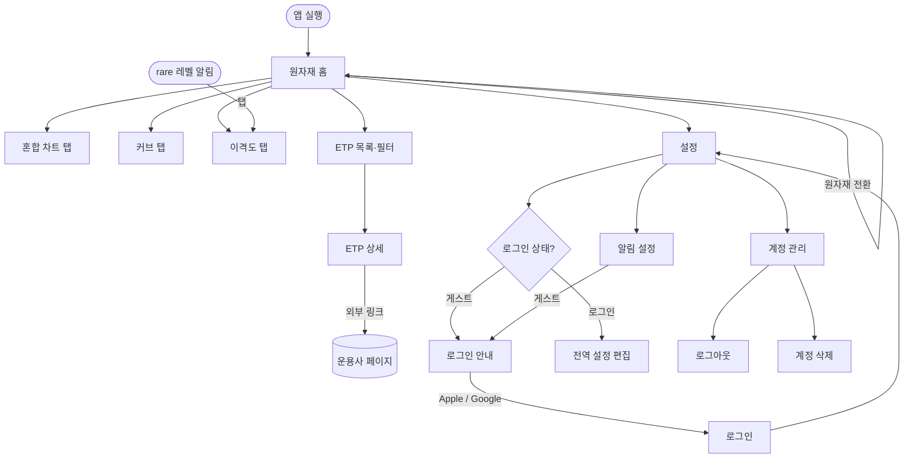

# 서비스 기획

> TODO.md 1단계 산출물. 기술 결정(tech-stack.md)의 입력이 된다.
> 결정 근거는 `decisions.md`, 화면 와이어프레임은 [`wireframes/screens.md`](wireframes/screens.md).

## 서비스 개요
- 목적: 원자재 선물 기반 ETP에 투자할 때 필요한데 기존 시세 서비스에는 없는 정보를 제공한다.
  - 원유·천연가스 같은 원자재 ETP는 선물을 보유하므로 월물 간 롤오버를 수반한다.
  - 인베스팅, 트레이딩뷰는 서비스가 정한 기준의 "대표 월물" 시세와 월물별 단순 시세만 보여 준다.
  - ETP는 자체 규칙으로 롤오버하므로 대표 월물 정보만으로는 실제 투자 대상의 흐름을 알기 어렵다.
- 대상 사용자: 국내(KRX)·미국 상장 원자재 선물 기반 ETP(ETF/ETN, 레버리지·인버스 포함)에 투자하는 개인 투자자
- 핵심 가치
  - 롤 규칙을 반영한 월물 혼합 지수로 ETP가 실제로 따라가는 흐름을 보여 준다.
  - 월물 커브로 콘탱고/백워데이션과 롤 비용을 수치로 보여 준다.
  - 이격도의 역사적 분포(rare 레벨)로 현재 가격이 얼마나 드문 구간인지 알려 주고, 도달하면 알림을 보낸다.

## 범위
- 원자재: 금(GC), 은(SI), WTI 원유(CL), 천연가스(NG)
  - 원유 기준(WTI/Brent)은 국내 상품의 기초자산을 리서치해 확정한다.
- 시장: 국내(KRX)와 미국 상장 ETP
- 상품: **선물 기반**이면서 **한 원자재만 추종하는** ETP
  - 레버리지·인버스 포함
  - 실물형(GLD, SLV 등)과 바스켓 상품(DBC 등) 제외
  - 상장폐지 상품 제외
- 시세 수집: 미국 선물(CME/NYMEX/COMEX)만. 국내 ETP도 같은 선물을 추종한다.
- 데이터: 무료 API로 제공할 수 있는 수준. 소스는 리서치 비교표를 보고 정한다.
- 언어: UI는 한국어·영어(i18n 처음부터 적용). 자동 수집한 ETP 텍스트는 원문 언어로 표시한다.
- 출시: MVP 전체를 한 번에 출시한다. 수익화만 이후 단계다.

## 용어
| 용어 | 정의 |
|---|---|
| 월물 | 만기월별 선물 계약. 예: CL 2026년 12월물 |
| 대표월물 | 거래량이 가장 많은 월물. 이 서비스의 기본 기준값 |
| 롤오버 | 만기가 다가온 월물을 팔고 다음 월물을 사서 보유를 이어 가는 것 |
| 기준값 | 차트와 알림에 쓰는 월물 조합 규칙. 대표월물 / 한국형 / 미국형 |
| 수익률 연결 지수 | 롤 비중에 따라 월물별 일일 수익률을 가중해 이어 붙인 지수. ETP NAV처럼 롤 시점의 가격 점프가 없다 |
| 가격 수준 맞춤 | 지수의 최신 값을 현재 혼합 가격과 같게 맞추고 과거 값을 같은 비율로 조정하는 것(back-adjusted) |
| 콘탱고 / 백워데이션 | 먼 월물 가격이 가까운 월물보다 높은 상태 / 낮은 상태 |
| 롤 수익률 | 롤오버로 생기는 이익(백워데이션) 또는 비용(콘탱고)을 연 단위로 환산한 값 |
| 이격도 | 지수가 이동평균선에서 떨어진 정도(%) |
| rare 레벨 | 최근 N년 이격도 분포에서 드물게 나타나는 구간의 경계(백분위) |
| CME 거래일 | 미국 중부 시간 17시에 바뀌는 선물 거래일. 주말과 CME 휴장일 제외 |

## 계산 정의
### 기준값
- **대표월물**(기본값): 원자재 공통으로 거래량이 가장 많은 월물
  - 다음 월물의 거래량이 현재 월물을 넘으면 그 월물로 옮긴다.
  - 판단은 전일 거래량으로 하고 다음 거래일부터 적용한다. 장중에는 확정된 대표월물을 쓴다.
  - 한 번 옮기면 이전 월물로 되돌아가지 않는다. 거래량이 엎치락뒤치락할 때 반복 전환을 막기 위해서다.
- **한국형 / 미국형**: 국내 / 미국 원자재 ETP 다수가 채택한 롤 규칙(롤 기간, 대상 월물, 일별 비중 이동)
  - 원자재별로 리서치해 정의한다.
  - 해당 시장에 상품이 1~2개뿐이면 그 상품의 규칙을 쓴다.
  - 비중은 ETP별 실제 비중이 아니라 규칙에 따라 날짜별로 재현한다.
- **기준값이 없는 원자재**: 전역 기준값이 한국형·미국형인데 그 원자재에 해당 상품이 없으면, 그 원자재만 대표월물로 대신 표시하고 안내한다. 알림도 같다.

### 시계열
- 종가는 CME 공식 정산가(settlement)를 쓴다. 이평선, 분포, 지수 모두 이 값으로 계산한다.
- 세 기준값 모두 **수익률 연결 지수**로 만든다.
- **가격 수준 맞춤**: 지수의 최신 값을 그 기준값의 현재 혼합 가격(Σ 비중 × 월물 가격)에 맞추고 과거 값은 같은 비율로 조정한다.
  - 지수와 월물 원가격이 같은 달러 단위가 된다.
  - 맞춤 비율은 매일 바뀐다. 서버는 원래 지수를 저장하고 응답할 때 비율 하나를 곱한다.
  - 지수의 과거 값은 실제 거래 가격이 아니라는 점을 차트에 안내한다.
- 지수의 고가·저가는 월물별 수익률을 비중으로 가중해 근사한다. 대표월물은 월물이 하나라 정확한 값이다.
- 장중 고가·저가는 소스가 주는 당일 고가·저가를 쓴다. 없으면 매시간 스냅숏의 최대·최소로 대신한다.

### 이격도와 rare 레벨
- 이격도 = `(지수 / 이평선 − 1) × 100`
  - 이평선은 종가 단순이동평균이다.
  - 장중에는 직전 (기간−1)일 종가와 현재가로 이평선을 계산한다. 분자는 판정 방향에 따라 고가나 저가를 쓴다.
  - 비율이라 가격 수준 맞춤의 영향을 받지 않는다.
- rare 레벨 = 최근 N년 일별 종가 이격도 분포의 백분위
  - 위 방향 p%: 이격도가 이 값을 넘은 날이 p%인 지점(100−p번째 백분위)
  - 아래 방향 p%: 이격도가 이 값보다 낮은 날이 p%인 지점(p번째 백분위)
  - 0 < p < 50이고, 5개 값은 서로 달라야 한다.
  - 데이터가 N년보다 짧으면 있는 만큼으로 계산하고 실제로 쓴 기간을 표시한다.
- 이격도 가이드선은 현재 시점의 최근 N년 분포로 구한 수평선이다. 과거 구간을 이동 백분위로 다시 그리지 않는다.

### 커브
- **M1**은 대표월물이고, 그 뒤에 상장된 월물을 차례로 M2, M3…로 둔다.
- 거래량이 기준 미만인 월물(예: 금·은의 비활성 월물)은 커브에서 뺀다. 기준값과 표시 개수 상한은 리서치로 정한다.
- 연환산 롤 수익률 = `(M1 / M2 − 1) × 365 / (M1과 M2의 만기 사이 일수) × 100`
  - 양수면 백워데이션(롤 이익), 음수면 콘탱고(롤 비용)

## 전역 설정
앱의 모든 차트와 알림에 적용한다. 로그인 사용자는 DB에 저장해 기기 간에 동기화한다. 게스트는 기본값으로 고정된다.

| 설정 | 선택지 | 기본값 |
|---|---|---|
| 차트 기준값 | 대표월물 / 한국형 / 미국형 | 대표월물 |
| 이평선 기간 | 20 / 50 / 100 / 200일 | 100일 |
| 분포 기간 N | 3 / 5 / 10년 / 전체 | 10년(데이터가 부족하면 가능한 최대) |
| rare 레벨 5개 | 자유 입력(0<p<50, 서로 다른 값) | 5 / 10 / 15 / 20 / 25 |
| 알림 대상 원자재 | 없음 / 4종 중 택1 | 없음(알림 꺼짐) |
| 언어 | 한국어 / 영어 | 기기 언어 |

서버는 원자재 4 × 기준값 3 × 이평선 4 = 48개 이격도 시계열을 미리 계산한다. 백분위는 N 4종별로 정렬해 둔 분포(192개)에서 바로 구하므로 rare 레벨을 자유 입력으로 받아도 부담이 없다.

## 핵심 기능 및 MVP 범위
| # | 기능 | 설명 | MVP 포함 |
|---|---|---|---|
| 1 | 원자재 홈 | 원자재 4종 전환, 탭 2~4, 기준 시각·지연 표시, 오늘 잠정값 | O |
| 2 | 월물 선 차트 | 기준값 지수와 월물 최대 5개를 달러 가격으로 비교 | O |
| 3 | 월물별 커브 | 상대 만기 커브, 과거 커브 비교, 스프레드·롤 수익률 | O |
| 4 | 이격도 차트 | 이격도와 rare 레벨 가이드선, 현재 백분위 위치 | O |
| 5 | ETP 목록·상세 | 자동 수집 목록, 5개 필터, 일반 정보 텍스트 | O |
| 6 | rare 레벨 알림 | 1시간 배치 판정, 푸시 발송(로그인 사용자) | O |
| 7 | 로그인·계정 | 게스트, Apple·Google 로그인, 설정 동기화, 계정 삭제 | O |
| 8 | 고지 | 투자 권유 아님, 데이터 출처와 지연 여부 | O |
| 9 | 광고·도네이션 | 앱 실행 시 광고, 도네이션으로 광고 제거 | X (이후) |
| 10 | Kakao 로그인 | | X (이후) |

### 1. 원자재 홈
- 상단에서 원자재 4종을 전환하고, 탭은 혼합 차트 / 커브 / 이격도다.
- 데이터 기준 시각과 지연 여부를 표시한다.
- 혼합 차트와 이격도 차트는 일별 종가 뒤에 **오늘의 잠정값**(최근 장중 스냅숏)을 점선으로 붙인다. 알림을 받은 사용자가 차트에서 같은 상황을 확인할 수 있게 하기 위해서다.
- 마지막으로 본 원자재는 기기에 기억한다.

### 2. 월물 선 차트
- 기본 선은 전역 기준값으로 만든 지수다.
- 현재 거래 중인 월물(커브에 표시되는 월물)을 최대 5개 골라 겹친다.
- 모든 선은 실제 달러 가격 수준으로 그린다. 지수는 가격 수준을 맞춘 값, 월물은 원가격이다.
- 기간: 1M / 3M / 6M / 1Y / 5Y / 전체. 개별 월물은 상장 이후 구간만 그린다.

### 3. 월물별 커브
- x축은 상대 만기 M1, M2, …이고, y축은 가격 또는 전일 종가 대비 등락률이다.
- 과거 커브는 1주 / 1개월 / 3개월 전 중에서 골라 겹친다.
- 수치 요약: M1→M2 스프레드(%)와 연환산 롤 수익률. 과거 커브를 겹치면 그 시점 값도 함께 보여 준다.

### 4. 이격도 차트
- 전역 기준값의 지수로 이격도를 그리고 rare 레벨을 위·아래 5개씩 가이드선으로 표시한다.
- 기간 선택은 기능 2와 같다.
- 분포에 실제로 쓴 기간과 현재 이격도의 백분위 위치(예: 상위 7%)를 보여 준다.

### 5. ETP 목록·상세
- 목록과 속성은 완전 자동 수집한다.
- 필터: 원자재, 상장시장(KRX/US), ETF/ETN, 배수, 환헤지 여부
  - 미국 상장 상품의 환헤지 값은 "해당 없음(환노출)"이다.
- 상세 화면은 일반 정보 텍스트(운용사, 기초지수, 보수, 상장일 등)와 운용사 페이지 링크만 보여 준다. 서비스 특화 차트는 넣지 않는다.

### 6. rare 레벨 도달 알림 (로그인 사용자만)
- 대상: 전역 설정의 원자재 1개와 기준값, 이평선, N, rare 레벨
- 판정: 1시간 배치로 하며 CME 거래일에만 돈다. 위 방향은 지수 고가, 아래 방향은 저가로 판정한다.
- 여러 레벨에 동시에 닿으면 가장 드문 레벨 1건만 보낸다. 그보다 덜 드문 레벨은 그날 보낸 것으로 처리한다.
- 같은 레벨·방향은 CME 거래일당 1회까지 보낸다. 같은 날 더 드문 레벨에 새로 닿으면 다시 보낸다.
- 장중에 설정을 바꾸면 바뀐 레벨 값으로 판정한다.
- 로그인한 모든 기기로 보내고, 문구는 사용자 언어를 따른다.
- 알림 내용: 원자재, 기준값, 방향, rare 레벨, 현재 이격도, 판정 시각
- 알림을 누르면 그 원자재의 이격도 탭으로 이동한다.
- OS 알림 권한이 거부돼 있으면 알림 설정 화면에 상태와 안내를 보여 준다.

### 7. 로그인·계정
- 게스트: 차트와 목록만 쓸 수 있다. 설정은 기본값으로 고정되고 알림이 없다. 설정이나 알림 화면에 들어가면 로그인을 안내한다.
- 로그인: iOS와 Android 모두 Apple·Google을 제공한다. Android의 Apple 로그인은 웹 방식이다.
- provider와 사용자 식별자(sub)만 저장하고 이메일은 저장하지 않는다.
- Apple 계정과 Google 계정은 서로 다른 계정으로 취급한다(계정 연결 없음).
- 로그아웃하면 그 기기의 푸시 토큰을 지운다.
- 계정 삭제는 앱 안에서 한다. 사용자, 설정, 토큰, 알림 기록을 모두 지우고 Apple 토큰을 폐기(revoke)한다.

### 8. 고지와 공통 동작
- 투자 권유가 아니라는 문구, 데이터 출처와 지연 여부를 설정 화면과 차트 하단에 표시한다.
- 날짜는 CME 거래일로, "기준 시각"은 기기 현지 시간으로 표시한다.
- 오프라인은 지원하지 않는다. 오류가 나면 다시 시도하는 화면을 보여 준다.

### 출시 전 필수
- 개인정보처리방침, Apple 개인정보 라벨, Google Play 데이터 보안 양식

### MVP 이후
- 수익화: 앱 실행 시 광고(App Open)를 보여 주고, 도네이션을 하면 광고를 없앤다.
  - 광고 제거는 디지털 혜택이라 인앱결제(IAP)가 필요할 가능성이 높다. IAP는 정해진 가격 단계만 허용하므로 "$1~$10000 자유 금액"은 여러 가격 상품으로 바꿔야 할 수 있다.
  - 데이터 모델에는 `ad_free` 자리만 남긴다.
- Kakao 로그인

## 서버 배치
| 배치 | 주기 | 하는 일 |
|---|---|---|
| 일일 정산 | CME 거래일마다 정산가 확정 후 1회 | 정산가·거래량 저장, 대표월물 전환 판단, 롤 비중 갱신, 지수·이평선·이격도·분포·커브 재계산 |
| 장중 | 1시간(CME 거래일만) | 월물 스냅숏 수집, 오늘 잠정 지수·이격도 계산, 알림 판정·발송 |
| ETP 목록 | 하루 1회 | 목록·속성 자동 수집, 상장폐지 상품 제외 |
| 거래일 달력 | 연 1회와 필요할 때 | CME 휴장일 갱신 |

앱은 자체 백엔드만 조회하고, 계산은 모두 서버에서 미리 한다.

## 사용자 흐름 / 화면 목록

| 화면 | 주요 요소 | 게스트 |
|---|---|---|
| 원자재 홈 | 원자재 전환, 탭 3개, 기준 시각·지연 표시, 고지 | 사용 가능(기본 설정) |
| 혼합 차트 탭 | 기준값 지수 + 월물 최대 5개, 기간 선택 | 사용 가능 |
| 커브 탭 | M1~Mn 커브, 가격/등락률 전환, 과거 커브, 스프레드·롤 수익률 | 사용 가능 |
| 이격도 탭 | 이격도 선, rare 가이드선 10개, 현재 백분위, 분포 기간 | 사용 가능 |
| ETP 목록 | 필터 5종, 목록 | 사용 가능 |
| ETP 상세 | 일반 정보 텍스트, 운용사 링크 | 사용 가능 |
| 설정 | 전역 설정, 언어, 고지·데이터 출처, 계정 | 보기만(로그인 안내) |
| 알림 설정 | 대상 원자재, 현재 레벨 요약, 권한 상태 | 로그인 안내 |
| 로그인 안내 | Apple·Google 버튼, 로그인 혜택 설명 | - |
| 계정 관리 | 로그인 provider, 로그아웃, 계정 삭제 | - |

## 와이어프레임
[`wireframes/screens.md`](wireframes/screens.md) (ASCII)

## 데이터 모델 초안
> Step 2에서 작성

## 외부 연동 요구사항
> Step 2에서 작성(리서치 결과 포함)
- 인증: Apple·Google(양 플랫폼)
- 결제: MVP 이후(IAP 도네이션)
- 푸시: FCM/APNs, 1시간 배치
- 외부 API: 리서치 후 결정

## 위험과 미결정 사항
- **데이터 소스**: 다음을 동시에 만족하는 무료 소스가 없을 가능성이 높다.
  - 상업적 이용·재표시 허용(CME는 지연 시세라도 재표시 라이선스가 필요할 수 있음)
  - 1시간 장중 고가·저가
  - 만기 월물의 일봉과 거래량 N년치
  - → 리서치 비교표를 보고 양보할 항목을 정한다.
- **ETP 완전 자동 수집**: 미국 상품의 배수, 환헤지, 선물 기반 여부가 잘못 분류될 수 있다. 분류 근거 필드를 리서치한다.
- **알림 빈도**: 분포는 종가 기준인데 판정은 장중 극값으로 한다. 그래서 알림이 분포보다 자주 울릴 수 있다.
  - 제안: 분포도 일봉 고가(위 방향)·저가(아래 방향) 이격도로 계산한다.
- **혼합 지수 고가·저가 근사 오차**
- **규제**: 유사투자자문업 해당 여부 확인(무료 정보 제공은 해당하지 않을 가능성이 높음)
- **나중에 정할 항목**: 운영 주체(개인/사업자, 수익화 단계에서 결정)
