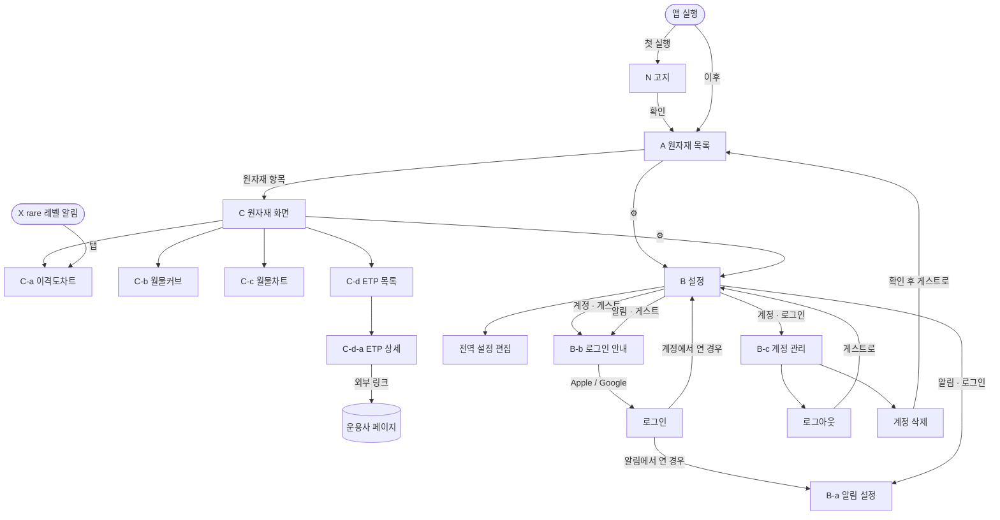

# 서비스 기획

> TODO.md 1단계 산출물. 기술 결정(tech-stack.md)의 입력이 된다.
> 결정 근거는 `decisions.md`, 화면 와이어프레임은 [`wireframes/screens.md`](wireframes/screens.md).
> 문서의 "Step 2"는 TODO 1단계의 리서치·데이터 모델·외부 연동 작업을 가리킨다.

## 서비스 개요
- 목적: 원자재 선물 기반 ETP에 투자할 때 필요한데 기존 시세 서비스에는 없는 정보를 제공한다.
  - 원유·천연가스 같은 원자재 ETP는 선물을 보유하므로 월물 간 롤오버를 수반한다.
  - 인베스팅, 트레이딩뷰는 서비스가 정한 기준의 "대표 월물" 시세와 월물별 단순 시세만 보여 준다.
  - ETP는 자체 규칙으로 롤오버하므로 대표 월물 정보만으로는 실제 투자 대상의 흐름을 알기 어렵다.
- 대상 사용자: 국내(KRX)·미국 상장 원자재 선물 기반 ETP(ETF/ETN, 레버리지·인버스 포함)에 투자하는 개인 투자자
- 핵심 가치
  - 롤 규칙을 반영한 월물 혼합 지수를 봉차트로 그리고 롤 구간을 표시해, ETP가 실제로 따라가는 흐름을 보여 준다.
  - 월물 커브로 기준일 대비 변화, 콘탱고/백워데이션, 롤 비용을 수치로 보여 준다.
  - 이격도의 역사적 분포(rare 레벨)를 이평선 기준 가격 밴드로 그려 현재 가격이 얼마나 드문 구간인지 알려 주고, 도달하면 알림을 보낸다.

## 범위
- 원자재: 금(GC), 은(SI), WTI 원유(CL), 천연가스(NG)
  - 원유는 WTI만 다룬다. Brent 추종 상품은 MVP에서 제외하고, 이후 원자재 추가 후보로 둔다.
- 시장: 국내(KRX)와 미국 상장 ETP
- 상품: **선물 기반**이면서 **한 원자재만 추종하는** ETP
  - 선물 기반 = 기초지수가 선물 지수인 상품. 보유 수단이 스왑이어도 포함한다(예: ProShares UGL·AGQ).
  - 레버리지·인버스 포함
  - 실물형(GLD, SLV 등)과 바스켓 상품(DBC 등) 제외
  - 상장폐지 상품 제외
  - **ETN 후속 시리즈**: 만기가 있는 ETN이 같은 조건으로 시리즈(코드 A, B…)를 바꿔 새로 상장하면 같은 상품으로 취급한다.
    - 겹치는 기간에는 두 시리즈의 정보(종목코드, 만기일 등)를 함께 표시한다.
    - 이전 시리즈가 상장폐지되면 그 시리즈 정보만 내리고 상품은 유지한다.
- 시세 수집: 미국 선물(CME/NYMEX/COMEX)만. 국내 ETP도 같은 선물을 추종한다.
- 데이터: 무료 API로 제공할 수 있는 수준. 소스는 리서치 비교표를 보고 정한다.
- 언어: UI는 한국어·영어(i18n 처음부터 적용). 자동 수집한 ETP 텍스트는 원문 언어로 표시한다.
- 출시: MVP 전체를 한 번에 출시한다. 수익화만 이후 단계다.

## 용어
| 용어 | 정의 |
|---|---|
| 월물 | 만기월별 선물 계약. 예: CL 2026년 12월물 |
| 대표월물 | 거래량 기준으로 정하는 이 서비스의 기본 월물. 전일 거래량으로 판단하고 이전 월물로 되돌아가지 않는다(계산 정의 참고) |
| 최근월물 | 만기가 가장 가까운 월물. 대표월물과 다를 수 있다 |
| 활성 월물 | 금속(금·은)에서 거래가 몰리는 월물. 금: 2·4·6·8·10·12월, 은: 3·5·7·9·12월. 금속은 나머지 월물(비활성 월물)을 서비스 전체에서 건너뛴다 |
| 대상 월물 | 서비스가 다루는 월물. 금속은 활성 월물만, 에너지(CL·NG)는 모든 월물 |
| M1 / M2 | 롤 수익률 계산의 기준 월물. M1은 대표월물, M2는 커브에 표시되는 그다음 월물 |
| 정산가(settlement) | CME가 매일 확정하는 공식 종가. 모든 계산의 기준 |
| 롤오버 | 만기가 다가온 월물을 팔고 다음 월물을 사서 보유를 이어 가는 것 |
| 롤 기간 / 롤 비중 | 한국형·미국형에서 월물을 옮겨 가는 기간 / 그 기간의 날짜별 월물 구성 비율 |
| 기준값 | 차트와 알림에 쓰는 월물 조합 규칙. 대표월물 / 한국형 / 미국형 |
| 수익률 연결 지수 | 롤 비중으로 혼합한 가격의 일일 변화율을 이어 붙인 지수. ETP NAV처럼 롤 시점의 가격 점프가 없다 |
| 가격 수준 맞춤 | 지수의 최신 값을 현재 혼합 가격과 같게 맞추고 과거 값을 같은 비율로 조정하는 것(back-adjusted) |
| 콘탱고 / 백워데이션 | 먼 월물 가격이 가까운 월물보다 높은 상태 / 낮은 상태 |
| 롤 수익률 | 롤오버로 생기는 이익(백워데이션) 또는 비용(콘탱고)을 연 단위로 환산한 값 |
| 이격도 | 지수가 이동평균선에서 떨어진 정도(%) |
| rare 레벨 | 최근 N년 이격도 분포에서 드물게 나타나는 구간의 경계(백분위) |
| rare-level 선 | rare 레벨의 이격도를 가격으로 바꾼 선. 이평선을 따라 움직이는 밴드 |
| 저점대비(LC) / 고점대비(HC) | 현재가가 화면에 보이는 구간의 최저가 / 최고가에서 떨어진 정도(%) |
| ETN 시리즈 | 만기가 있는 ETN이 같은 조건으로 코드(A, B…)를 바꿔 다시 상장한 것. 같은 상품으로 취급한다 |
| CME 거래일 | 미국 중부 시간 17시에 바뀌는 선물 거래일. 주말과 CME 휴장일 제외 |
| CME 거래 시간 | Globex 거래 시간. 일~금 17:00~익일 16:00 CT. 매일 16:00~17:00 CT 휴식, 휴장일, 조기 마감 이후는 제외한다. 이 밖의 시간이 휴장이다 |

## 계산 정의
### 기준값
- **대표월물**(기본값): 원자재 공통으로 거래량이 가장 많은 월물
  - 후보는 대상 월물만이다(금속은 활성 월물).
  - 현재보다 만기가 늦은 후보 중 전일 거래량이 현재 월물을 넘는 것이 있으면, 그중 거래량이 가장 많은 월물로 옮긴다.
  - 판단은 전일 거래량으로 하고 다음 거래일부터 적용한다. 장중에는 확정된 대표월물을 쓴다.
  - 한 번 옮기면 이전 월물로 되돌아가지 않는다. 거래량이 엎치락뒤치락할 때 반복 전환을 막기 위해서다.
  - 안전장치: 현재 월물이 최종 거래일에 도달하면 거래량과 관계없이 다음 거래일에 위 규칙으로 고른 월물(없으면 만기순 다음 대상 월물)로 옮긴다.
- **한국형 / 미국형**: 국내 / 미국 원자재 ETP 다수가 채택한 롤 규칙(롤 기간, 대상 월물, 일별 비중 이동)
  - 원자재별로 리서치해 정의한다.
  - 다수는 상품 수 기준이고, 동률이면 운용자산(AUM)이 큰 쪽의 규칙을 쓴다.
  - 해당 시장에 상품이 1~2개뿐이면 그 상품의 규칙을 쓴다.
  - 비중은 ETP별 실제 비중이 아니라 규칙에 따라 날짜별로 재현한다.
- **기준값이 없는 원자재**: 전역 기준값이 한국형·미국형인데 그 원자재에 해당 상품이 없으면, 그 원자재만 대표월물로 대신 표시하고 안내한다. 알림도 같다.

### 시계열
- 종가는 CME 공식 정산가(settlement)를 쓴다. 이평선, 분포, 지수 모두 이 값으로 계산한다.
- 세 기준값 모두 **수익률 연결 지수**로 만든다.
  - 일일 수익률(t) = `Σ w(t-1)·P(t) / Σ w(t-1)·P(t-1) − 1` (w: 전일 롤 비중, P: 월물 가격). 분자·분모에 같은 비중을 쓴다(S&P GSCI 방식).
  - 월물 하나의 가격이 음수여도 계산된다(예: 2020-04-20 WTI 5월물 −37.63).
  - 혼합 가격이 0 이하가 되면 그날 지수는 산출하지 않고 차트에 "산출 불가"로 표시한다(log 축도 그릴 수 없음).
    - 다음 유효일의 수익률은 분모로 직전 유효일의 혼합 가격을 써서 이어 붙인다. 지수가 끊기지 않게 하기 위해서다.
    - 이 기간은 이평선·이격도·분포 계산에서도 뺀다.
- **가격 수준 맞춤**: 지수의 최신 값을 그 기준값의 현재 혼합 가격(Σ 비중 × 월물 가격)에 맞추고 과거 값은 같은 비율로 조정한다.
  - 지수와 월물 원가격이 같은 달러 단위가 된다.
  - 맞춤 비율은 매일 바뀐다. 서버는 원래 지수를 저장하고 응답할 때 비율 하나를 곱한다.
  - 현재 혼합 가격이 0 이하이면 새 비율을 구하지 않고 직전 비율을 그대로 쓴다.
  - 지수의 과거 값은 실제 거래 가격이 아니라는 점을 차트에 안내한다.
- 지수의 시가·고가·저가는 월물별 시가·고가·저가를 위 공식(전일 비중)에 넣어 근사한다. 대표월물은 월물이 하나라 정확한 값이다.
- 장중 고가·저가는 소스가 주는 당일 고가·저가를 쓴다. 없으면 매시간 스냅숏의 최대·최소로 대신한다.

### 이격도와 rare 레벨
- 이격도 = `(지수 / 이평선 − 1) × 100`
  - 이평선은 종가 단순이동평균이다.
  - 과거 날짜는 종가(정산가), 오늘은 현재가(최근 스냅숏)로 이평선과 분자를 계산한다. 차트와 화면에 표시하는 이격도는 모두 이 값이다.
  - 알림 판정에만 고가·저가를 쓴다. 위 방향은 오늘 값을 고가로, 아래 방향은 저가로 바꿔 이평선과 분자를 함께 계산한다.
  - 비율이라 가격 수준 맞춤의 영향을 받지 않는다.
- rare 레벨 = 최근 N년 일별 종가 이격도 분포의 백분위
  - 위 방향 p%: 이격도가 이 값을 넘은 날이 p%인 지점(100−p번째 백분위)
  - 아래 방향 p%: 이격도가 이 값보다 낮은 날이 p%인 지점(p번째 백분위)
  - p는 0.1~49.9(소수 첫째 자리까지)이고, 5개 값은 서로 달라야 한다(전역 설정 참고).
  - 백분위는 선형 보간으로 구한다.
  - 이평선 기간이 차기 전의 초기 (기간−1)일은 이격도가 없으므로 분포에서 뺀다.
  - 데이터가 N년보다 짧으면 있는 만큼으로 계산하고 실제로 쓴 기간을 표시한다.
- **rare-level 선** = `이평선(t) × (1 + 레벨 이격도 / 100)`
  - 레벨 이격도는 현재 시점의 최근 N년 분포로 구한 고정값이다. 과거 구간을 이동 백분위로 다시 계산하지 않는다.
  - 그래서 선은 수평선이 아니라 이평선을 따라 움직이는 가격 밴드가 된다. 위 5개 + 아래 5개다.
- **저점대비(LC)** = `(현재가 / 보이는 구간 최저가 − 1) × 100`, **고점대비(HC)** = `(현재가 / 보이는 구간 최고가 − 1) × 100`
  - 최저가 / 최고가는 보이는 구간 봉들의 저가 중 최저 / 고가 중 최고다.
  - 현재가는 오늘 잠정 봉의 종가(최근 스냅숏)다.

### 월물 목록
- 홈(A)과 월물차트(C-c)는 가장 가까운 대상 월물부터 **만기순 5개**를 쓴다. 거래량은 따지지 않는다.
  - 에너지는 연속된 5개 월물, 금속은 비활성 월물을 건너뛴 활성 월물 5개다(예: 금 DEC26, FEB27, APR27, JUN27, AUG27).
- 만기된 월물은 다음 CME 거래일에 목록에서 빠진다.
- 현재가가 없는 월물은 마지막 정산가를 보여 주고 "거래 없음"으로 표시한다.
- 대표월물이 5개 안에 없으면 6번째로 덧붙인다(안전장치).

### 커브
- x축은 대상 월물(만기순)이다. 금속은 활성 월물만 쓴다.
  - 먼 월물 중 거래량이 기준 미만인 월물은 뺀다. 기준값과 표시 개수 상한은 리서치로 정한다.
  - 홈·월물차트의 "5개" 규칙과 달리 개수를 고정하지 않는다.
- 기준일 비교: D = 최근 CME 거래일, 기준일은 기본 D-1이고 거래일 단위로 옮긴다.
  - D의 값은 장중에는 최근 스냅숏, 장 마감 뒤에는 정산가다.
  - 기준일과 D 사이에 만기된 월물은 기준일 커브에만 표시한다.
  - 기준일 뒤에 새로 상장된 월물은 D 커브에만 표시하고 변화율을 계산하지 않는다.
- 롤 수익률의 **M1**은 대표월물이고, M1 뒤에서 커브에 표시되는 월물을 차례로 M2, M3…로 둔다.
- 연환산 롤 수익률 = `(M1 / M2 − 1) × 365 / (M1과 M2의 만기 사이 일수) × 100`
  - 양수면 백워데이션(롤 이익), 음수면 콘탱고(롤 비용)

## 전역 설정
모든 원자재에 공통으로 적용한다(화면 B).
- 이격도차트 설정: 게스트는 기기에 저장하고 바꿀 수 있다. 로그인 사용자는 DB에 저장해 기기 간에 동기화한다.
  - 로그인할 때 기기 설정을 DB로 옮긴다. DB에 이미 설정이 있으면 DB 값을 쓴다.
  - 로그아웃하면 마지막 값을 기기 설정으로 남긴다.
- 알림 대상과 알림 거부 시간: 로그인 사용자만 정할 수 있다(DB 저장).
- 표시 설정(언어, 등락 색): 기기에 저장하고 게스트도 바꿀 수 있다. 로그인 사용자의 언어는 푸시 문구용으로 서버에도 전달한다.

| 구분 | 설정 | 선택지 | 기본값 |
|---|---|---|---|
| 이격도차트 | 차트 기준값 | 대표월물 / 한국형 / 미국형 | 대표월물 |
| 이격도차트 | 기준 이평선 | 20 / 50 / 100 / 200일 | 100일 |
| 이격도차트 | 분포 기간 N | 3 / 5 / 10년 / 전체 | 10년(데이터가 부족하면 가능한 최대) |
| 이격도차트 | rare 레벨 5개 | 자유 입력(0.1~49.9, 소수 첫째 자리까지, 서로 다른 값) | 5 / 10 / 15 / 20 / 25 |
| 이격도차트 | 알림 대상 원자재 | 없음 / 4종 중 택1 | 없음(알림 꺼짐) |
| 이격도차트 | 알림 거부 시간 | 끄기 / 시작~종료(기기 현지 시간, 30분 단위, 자정 넘김 허용) | 끄기 |
| 표시 | 언어 | 한국어 / 영어 | 기기 언어 |
| 표시 | 등락 색 | 한국식(상승 빨강·하락 파랑) / 미국식(상승 초록·하락 빨강) | 기기 지역이 한국이면 한국식, 그 밖은 미국식 |

rare 레벨 입력
- 입력란 아래에 허용 범위(0.1~49.9, 소수 첫째 자리까지)와 "서로 다른 값 5개"를 안내한다.
- 범위를 벗어나거나 중복이면 그 자리에서 오류를 보여 주고 저장을 막는다.
- 저장할 때 오름차순으로 정렬한다.
- 50은 위·아래 선이 중앙값에서 겹쳐 "드문 구간"의 의미가 없으므로 허용하지 않는다.

월물커브(C-b)와 월물차트(C-c)는 등락 색 외의 설정을 쓰지 않는다.

서버는 원자재 4 × 기준값 3 × 이평선 4 = 48개 이격도 시계열을 미리 계산한다. 백분위는 N 4종별로 정렬해 둔 분포(192개)에서 바로 구하므로 rare 레벨을 자유 입력으로 받아도 부담이 없다.

## 핵심 기능 및 MVP 범위
| # | 기능 | 설명 | MVP 포함 |
|---|---|---|---|
| 1 | 원자재 목록(A) | 원자재별 월물 5개 시세, 대표월물·알림 표시, 기준 시각·지연 | O |
| 2 | 이격도차트(C-a) | 기준값 지수 일봉, 이평선, rare-level 밴드, 롤 구간, 이격도·LC/HC | O |
| 3 | 월물커브(C-b) | 기준일 대비 현재 커브, 기준일 이동, 스프레드·롤 수익률 | O |
| 4 | 월물차트(C-c) | 월물 5개 원가격 선 비교 | O |
| 5 | ETP 목록·상세(C-d) | 자동 수집 목록, 4개 필터, 일반 정보 텍스트 | O |
| 6 | rare 레벨 알림 | 1시간 배치 판정, 푸시 발송(로그인 사용자) | O |
| 7 | 로그인·계정 | 게스트, Apple·Google 로그인, 설정 동기화, 계정 삭제 | O |
| 8 | 고지 | 투자 권유 아님, 데이터 출처와 지연 여부 | O |
| 9 | 광고·도네이션 | 앱 실행 시 광고, 도네이션으로 광고 제거 | X (이후) |
| 10 | Kakao 로그인 | | X (이후) |

> 화면별 레이아웃과 세부 동작은 [`wireframes/screens.md`](wireframes/screens.md)가 기준이다. 여기서는 기능 범위만 적는다.

### 1. 원자재 목록(A)
- 대상 원자재를 목록으로 보여 준다. 원자재는 추가될 수 있다.
- 원자재마다 대상 월물 5개(월물 목록 규칙)의 현재가·전일 대비·등락률을 보여 준다. 대표월물에는 표시를 붙인다.
- 알림 대상 원자재에는 알림 아이콘을 붙인다.
- 데이터 기준 시각, 지연 여부, 장 상태를 표시한다. 당겨서 새로고침을 지원하고, 자동 새로고침 주기는 데이터 제약 리서치 후 정한다.
- 항목을 누르면 원자재 화면(C)의 이격도차트 탭으로 간다.

### 2. 이격도차트(C-a)
- 전역 기준값의 지수를 일봉 봉차트(log y축)로 그린다. 오늘 봉은 최근 장중 스냅숏으로 만든 잠정값이다. 알림을 받은 사용자가 차트에서 같은 상황을 확인할 수 있게 하기 위해서다.
- 이평선과 rare-level 선(위·아래 5개씩)을 겹친다.
- 선택된 기준값의 롤 정보만 표시한다. 대표월물이면 전환일 마커와 새 월물명(예: →FEB27), 한국형·미국형이면 그 규칙의 롤 기간 음영이다.
- 오늘 OHLC, 현재 이격도와 백분위, 저점대비·고점대비, 보이는 구간의 최고·최저가 꼬리표를 보여 준다.
  - 백분위는 가까운 꼬리 기준이다. 중앙값보다 위면 "상위 p%", 아래면 "하위 p%"(예: 하위 9%).
- 기간 버튼 3M / 6M / 9M / 12M / 2Y / 4Y / 6Y / 8Y / 10Y / 전체와 핀치·드래그로 범위를 정한다.
- 길게 누르면 십자선과 선택일 상세(OHLC, 전일 대비, 이격도, 롤 비중)를 보여 준다.
  - 롤 비중: 대표월물은 그날의 월물명(예: DEC26), 한국형·미국형은 월물별 비중(예: DEC26 60% · JAN27 40%).

### 3. 월물커브(C-b)
- 기준일 종가 커브와 현재(D) 커브를 겹치고, 월물별 변화율을 보여 준다.
- 기준일은 기본 D-1이고, −/+로 거래일 단위로 옮기며, 0으로 D-1에 돌아온다.
- 수치 요약: 커브 상태, M1→M2 스프레드(%), 연환산 롤 수익률(현재와 기준일).
  - 커브 상태는 M1→M2로 판정하고 기준을 함께 쓴다(예: 콘탱고 (M1→M2)). 천연가스처럼 계절성으로 구간마다 형태가 섞이기 때문이다.
  - 한 달 간격 스프레드를 연환산하면 천연가스는 ±100%를 넘을 수 있다. 그대로 표시한다.

### 4. 월물차트(C-c)
- A와 같은 월물 5개의 원가격을 각각 상장일부터 선으로 그려 겹친다.
- 기간과 제스처는 C-a와 같다. 혼합 지수선은 그리지 않는다.

### 5. ETP 목록·상세
- 목록과 속성은 완전 자동 수집한다.
- ETN 후속 시리즈는 한 항목으로 묶고, 겹치는 기간에는 두 시리즈를 병기한다(범위 참고).
- 목록은 현재 원자재(C)의 상품만 보여 준다. 원자재 필터는 두지 않는다.
- 필터: 상장시장(전체/KRX/US), 유형(전체/ETF/ETN), 배수, 환헤지 여부
- 기본 정렬: 시장(KRX → US), 배수(양수 먼저, 각각 절댓값 오름차순. 예: 1x → 2x → 3x → −1x → −2x), 이름순. 순자산(AUM) 정렬은 자동 수집 가능 여부를 리서치한 뒤 정한다.
  - 미국 상장 상품의 환헤지 값은 "해당 없음(환노출)"이다.
- 상세 화면은 일반 정보 텍스트(운용사, 기초지수, 보수, 상장일 등)와 운용사 페이지 링크만 보여 준다. 서비스 특화 차트는 넣지 않는다.

### 6. rare 레벨 도달 알림 (로그인 사용자만)
- 대상: 전역 설정의 원자재 1개와 기준값, 이평선, N, rare 레벨
- 판정: 1시간 배치로 하며 CME 거래 시간에만 돈다. 위 방향은 지수 고가, 아래 방향은 저가로 판정한다(이격도 계산 정의 참고).
  - 실시간 판정이 아니라 직전 배치 이후 레벨 도달이 있었는지 감지하는 방식이다. 그래서 알림을 누르고 들어온 시점의 현재가 기준 이격도와 다를 수 있으며, 이는 정상 동작이다.
- 한 방향에서 여러 레벨에 동시에 닿으면 가장 드문 레벨 1건만 보낸다. 그보다 덜 드문 레벨은 그날 보낸 것으로 처리한다.
- 같은 레벨·방향은 CME 거래일당 1회까지 보낸다. 같은 날 더 드문 레벨에 새로 닿으면 다시 보낸다.
- 장중에 설정을 바꾸면 바뀐 설정으로 판정한다.
  - 발송 기록의 키는 원자재 + 기준값 + 이평선 + N + 방향 + 레벨 값 + CME 거래일이다.
  - 이 중 하나라도 바꾸면 새 조건은 보낸 적이 없는 것으로 보고, 그날 다시 보낼 수 있다(의도된 동작).
- 로그인한 모든 기기로 보내고, 문구는 사용자 언어를 따른다.
- 알림 내용: 원자재, 기준값, 방향, rare 레벨, 판정 이격도(고가·저가 기준), 판정 시각
- **알림 거부 시간**: 거부 시간 중에 생긴 알림은 보류했다가 종료 시각에 지연 발송한다.
  - 시작·종료는 기기 현지 시간 기준 30분 단위(:00/:30)다. 자정을 넘는 구간(예: 23:00~07:00)을 허용하고, 시작과 종료가 같으면 저장을 막는다.
  - 사용자 시간대(IANA)를 서버에 함께 저장한다. 앱 실행 때 시간대가 바뀌었으면 갱신한다.
  - 거부 시간 중에도 판정은 그대로 하고 발송만 보류한다. 보류한 건도 그날 보낸 것으로 쳐서 중복 방지 규칙을 똑같이 적용한다.
  - 종료 시각에 보류 건이 여러 개면 방향별로 가장 드문 1건만 보낸다. 본문에 감지 시각과 지연 발송을 표시한다(예: 03:00 감지 · 지연 발송).
  - 보류 중에 CME 거래일이 바뀌거나 종료 시각이 휴장 중이어도 보낸다.
  - 거부 시간을 끄거나 바꿔서 지금이 거부 시간 밖이 되면 다음 지연 발송 작업(최대 30분 뒤)에서 보낸다.
- 알림을 누르면 그 원자재의 원자재 화면(C)으로 가서 이격도차트(C-a) 탭을 연다.
- OS 알림 권한이 거부돼 있으면 알림 설정 화면에 상태와 안내를 보여 준다.
- 알림 설정 화면에 "차트의 rare-level 선에 오늘 봉의 꼬리가 닿으면 알림. 장중 터치 기준이라 p%보다 자주 울릴 수 있음"을 안내한다.

### 7. 로그인·계정
- 게스트: 차트, 목록, 모든 설정(기기 저장)을 쓸 수 있다. 알림과 기기 간 동기화만 없다. 알림 설정을 누르면 로그인 안내(B-b)로 가고, 로그인을 마치면 알림 설정(B-a)으로 간다.
- 로그인: iOS와 Android 모두 Apple·Google을 제공한다. Android의 Apple 로그인은 웹 방식이다.
- provider와 사용자 식별자(sub)만 저장하고 이메일은 저장하지 않는다.
  - 예외: Apple 로그인 사용자는 계정 삭제 시 토큰 폐기(revoke)에 필요한 refresh token을 암호화해 저장하고, 계정 삭제 때 함께 지운다.
- Apple 계정과 Google 계정은 서로 다른 계정으로 취급한다(계정 연결 없음).
- 로그아웃하면 그 기기의 푸시 토큰을 지운다.
- 계정 삭제는 앱 안에서 한다. 사용자, 설정, 토큰, 알림 기록을 모두 지우고 Apple 토큰을 폐기(revoke)한다.

### 8. 고지와 공통 동작
- 첫 실행 때 "투자 권유 아님 · 지연 데이터" 고지를 한 번 보여 주고 확인을 받는다. 그 뒤에는 투자 권유 아님 문구와 데이터 출처를 설정(B)에 상시 둔다.
- 데이터 기준 시각, 지연 여부, 장 상태(장중/휴장)는 A와 C 화면 상단에 표시한다. 장 상태는 CME 거래 시간 달력으로 판단한다.
- 테마는 다크 전용이다. 화면은 세로가 기본이고, C-a~C-c만 버튼으로 가로 전환할 수 있다.
- 차트·커브의 날짜는 CME 거래일로 표시한다.
- 기준 시각 줄은 `10/23 06:30 기준 · 거래일 10/22 · 지연 · 휴장` 형식이다.
  - 기준 시각은 기기 현지 날짜·시간이고, 거래일은 CME 거래일을 따로 표시한다.
  - 현지 날짜와 CME 거래일이 다를 수 있기 때문이다(예: KST 10/23 06:30 = CT 10/22 16:30).
- 오프라인은 지원하지 않는다. 오류가 나면 다시 시도하는 화면을 보여 준다.

### 출시 전 필수
- 개인정보처리방침, Apple 개인정보 라벨, Google Play 데이터 보안 양식

### MVP 이후
- 수익화: 앱 실행 시 광고(App Open)를 보여 주고, 도네이션을 하면 광고를 없앤다.
  - 광고 제거는 디지털 혜택이라 인앱결제(IAP)가 필요할 가능성이 높다. IAP는 정해진 가격 단계만 허용하므로 "$1~$10000 자유 금액"은 여러 가격 상품으로 바꿔야 할 수 있다.
  - 데이터 모델에는 `ad_free` 자리만 남긴다.
- Kakao 로그인
- 차트 후보: 거래량 보조 차트, 주봉·월봉, C-c % 비교 모드, 차트 공유·스크린샷, 차트에서 알림 만들기

## 서버 배치
| 배치 | 주기 | 하는 일 |
|---|---|---|
| 일일 정산 | CME 거래일마다 확정 정산가 발표 후 1회(시각은 Step 2) | 전일 정산가 정정 확인(바뀌었으면 재계산), 정산가·거래량 저장, 대표월물 전환 판단, 롤 비중 갱신, 지수·이평선·이격도·분포·커브 재계산 |
| 장중 | 1시간, CME 거래 시간에만(휴장 중 중지) | 월물 스냅숏 수집, 오늘 잠정 지수·이격도 계산, 알림 판정·발송 |
| 지연 발송 | 30분(:00/:30), 장과 무관 | 알림 거부 시간이 끝난 사용자의 보류 알림 발송 |
| ETP 목록 | 하루 1회, 장과 무관(시각은 원천 갱신 주기에 맞춰 Step 2) | 목록·속성 자동 수집, ETN 후속 시리즈 묶기, 상장폐지 상품 제외(이전 시리즈는 그 시리즈 정보만 내림) |
| 거래일 달력 | 연 1회와 필요할 때 | CME 휴장일과 조기 마감 시각 갱신 |

앱은 자체 백엔드만 조회하고, 계산은 모두 서버에서 미리 한다.

- 배치 일정은 America/Chicago 시간대로 잡는다. 서머타임이 바뀌어도 CME 거래 시간과 어긋나지 않게 하기 위해서다.
- 일일 정산은 거래 시간과 관계없이 확정 정산가 발표 후 1회 돈다.

배치 실패 시
- 앱은 마지막으로 성공한 데이터와 그 기준 시각을 보여 준다(상단 기준 시각 줄로 데이터가 오래됐음을 알 수 있다).
- 서버는 실패한 배치를 다음 주기 전에 1회 다시 시도한다.
- 일일 정산이 실패한 상태에서는 알림 판정을 멈춘다. 잘못된 이평선·분포로 알림을 보내지 않기 위해서다.
- 운영자 모니터링(실패 알림) 방식은 TODO 3단계(아키텍처)에서 정한다.

## 사용자 흐름 / 화면 목록

흐름 규칙
- N: 첫 실행 때만 보인다. 확인하면 다시 보이지 않는다.
- X로 들어오면 앱이 꺼져 있었어도 화면 스택을 A → C로 만든다. C에서 [←]를 누르면 A로 간다.
- 로그인을 마치면 B의 계정에서 열었으면 B로, 알림에서 열었으면 B-a로 간다.
- 로그아웃하면 게스트 상태로 B에 남고, 설정은 기기에 남는다.
- 계정 삭제는 확인 대화상자를 거친다. 삭제 후 기기의 이격도차트 설정을 기본값으로 초기화하고 게스트 상태로 A에 간다. 표시 설정, 고지 확인 여부, 기간 버튼 선택은 유지한다.

| ID | 화면 | 주요 요소 | 게스트 |
|---|---|---|---|
| N | 고지 | 투자 권유 아님 · 지연 데이터 문구, 확인 버튼(첫 실행 1회) | 사용 가능 |
| A | 원자재 목록 | 원자재별 월물 5개 시세, 대표월물·알림 표시, 기준 시각·지연 | 사용 가능 |
| B | 설정 | 계정, 표시 설정, 이격도차트 설정, 고지·데이터 출처 | 사용 가능(기기 저장, 알림만 로그인 안내) |
| B-a | 알림 설정 | 대상 원자재, 현재 레벨 요약, 알림 거부 시간, 권한 상태 | 로그인 안내(B-b) |
| B-b | 로그인 안내 | Apple·Google 버튼, 로그인 혜택 설명 | - |
| B-c | 계정 관리 | 로그인 provider, 로그아웃, 계정 삭제 | - |
| C | 원자재 화면 | title-bar, tab-bar 4개, 가로 전환 | 사용 가능 |
| C-a | 이격도차트 | 지수 일봉, 이평선, rare-level 밴드, 롤 구간, 십자선 | 사용 가능 |
| C-b | 월물커브 | 기준일 vs 현재 커브, 기준일 이동, 스프레드·롤 수익률 | 사용 가능 |
| C-c | 월물차트 | 월물 5개 원가격 선 | 사용 가능 |
| C-d | ETP 목록 | 필터 4종, 목록 | 사용 가능 |
| C-d-a | ETP 상세 | 일반 정보 텍스트, 운용사 링크 | 사용 가능 |
| X | 푸시 알림 | 원자재, 기준값, 방향, rare 레벨, 판정 이격도, 판정 시각 | 없음 |

## 와이어프레임
[`wireframes/screens.md`](wireframes/screens.md) (ASCII)

## 데이터 모델 초안
> Step 2에서 작성

## 외부 연동 요구사항
> Step 2에서 작성(리서치 결과 포함)
- 인증: Apple·Google(양 플랫폼)
- 결제: MVP 이후(IAP 도네이션)
- 푸시: FCM/APNs, 1시간 배치
- 외부 API: 리서치 후 결정

## 위험과 미결정 사항
- **데이터 소스**: 다음을 동시에 만족하는 무료 소스가 없을 가능성이 높다.
  - 상업적 이용·재표시 허용(CME는 지연 시세라도 재표시 라이선스가 필요할 수 있음)
  - 1시간 장중 고가·저가
  - 만기 월물의 일봉과 거래량 N년치
  - → 리서치 비교표를 보고 양보할 항목을 정한다.
- **ETP 완전 자동 수집**: 미국 상품의 배수, 환헤지, 선물 기반 여부가 잘못 분류될 수 있다. 분류 근거 필드(기초지수명 등)를 리서치한다.
  - ETN 후속 시리즈를 같은 상품으로 묶는 기준(발행사·기초지수·배수 일치, 종목명 패턴 등)도 리서치한다.
- **혼합 지수 고가·저가 근사 오차**: 한국형·미국형은 롤 기간에 고가·저가가 근사값이라 알림 판정이 실제와 어긋날 수 있다. 롤 기간 밖에서는 월물이 하나라 정확하고, 롤 기간은 한 달에 일주일 정도라 감수한다.
- **정산가 정정**: 드물게 정산가가 나중에 정정된다. 다음 날 배치에서 확인해 재계산한다(서버 배치 참고).
- **금속 활성 월물 달력 변경**: CME가 활성 월물을 바꾸면 월물 목록·커브·대표월물 후보가 달라진다. 달력을 데이터로 관리한다.
- **Apple refresh token 보관**: 암호화 저장에 쓰는 키 관리 방식 → TODO 3단계(아키텍처)에서 결정
- **시세 새로고침 주기**: 홈 현재가를 실시간으로 갱신할 수 있는지는 데이터 소스 제약에 달려 있다. 지금 서버 구조는 1시간 배치다. → Step 2 리서치 후 결정
- **차트 구간 데이터 로딩**: 핀치·드래그로 화면 밖 구간을 볼 때 전체를 한 번에 받을지, 구간을 추가로 받을지 → TODO 3단계(아키텍처)에서 결정
- **장기 일봉 밀도**: 10년·전체를 일봉으로 그리면 봉이 매우 얇다. 가로 모드와 확대로 보완하고, 주봉·월봉은 MVP 이후 후보로 둔다.
- **규제**: 유사투자자문업 해당 여부 확인(무료 정보 제공은 해당하지 않을 가능성이 높음)
- **나중에 정할 항목**: 운영 주체(개인/사업자, 수익화 단계에서 결정)

### 결정된 사항
- **알림 빈도**: 분포는 종가 기준으로 유지한다(D-002). 알림은 장중 터치 기준이라 p%보다 자주 울릴 수 있고, 이를 B-a에 안내한다.
