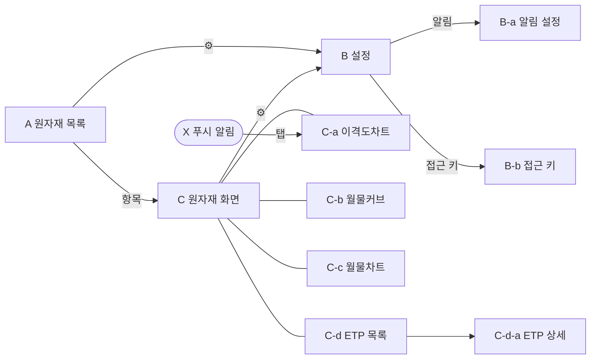

# 화면 와이어프레임 (ASCII)

> 화면 정의와 동작은 [`../product.md`](../product.md) 기준. 레이아웃 초안이며 실제 디자인은 개발 단계에서 정한다.
> 화면 ID(A, B, C …)는 문서·이슈·코드에서 화면을 가리키는 공통 이름으로 쓴다.

## 화면 목록

| ID | 화면 | 진입 | 상태 |
|---|---|---|---|
| A | 원자재 목록(홈) | 앱 실행 | MVP 확정 |
| B | 설정 | A·C title-bar ⚙ | MVP 확정 |
| B-a | 알림 설정 | B > 알림 | MVP 확정(레이아웃은 개발 단계에서 다듬음) |
| B-b | 접근 키 | 첫 실행, B > 접근 키, 서버가 키를 거절할 때 | MVP 확정(레이아웃은 개발 단계에서 다듬음, D-044) |
| C | 원자재 화면 | A에서 원자재 항목, X 알림 | MVP 확정 |
| C-a | 이격도차트 탭 | C 기본 탭 | MVP 확정 |
| C-b | 월물커브 탭 | C tab-bar | MVP 확정 |
| C-c | 월물차트 탭 | C tab-bar | MVP 확정 |
| C-d | ETP 목록 탭 | C tab-bar | MVP 확정(레이아웃은 개발 단계에서 다듬음) |
| C-d-a | ETP 상세 | C-d 항목 | MVP 확정(레이아웃은 개발 단계에서 다듬음) |
| X | 푸시 알림 | rare-level 도달 | MVP 확정(레이아웃은 개발 단계에서 다듬음) |



## 공통 규칙
- 테마: 다크 전용
- 등락 색: B 설정을 따른다. 한국식(상승 빨강 / 하락 파랑), 미국식(상승 초록 / 하락 빨강). 기본값은 기기 지역이 한국이면 한국식, 그 밖은 미국식. 색은 화면에 쓴 반올림 값의 부호로 고르고, 0(`0.0%` 등)이면 방향 없는 색(`colors.neutral`)이다. 변화량과 등락률을 함께 쓰는 줄(A 시세, C-a 전일 대비)은 둘 다 0일 때만 방향 없는 색이고, 아니면 0이 아닌 쪽의 부호를 따른다
- 가격 소수 자릿수: NG 3, CL 2, GC 1, SI 3
- 기준 시각 줄: `10/22 09:00 기준 · 거래일 10/22 · 지연 · 장중|휴장|정산 대기`(가운데 정렬). 화면 최하단 줄이다(C는 tab-bar 아래, 홈 인디케이터 여백 위). 차트 위쪽 정보 줄(C-a 오늘 OHLC·이격도, C-b 범례·롤 수익률, C-c 범례)도 가운데 정렬한다. C-a~C-c의 이 정보 줄은 모두 차트 영역 안 위쪽에 반투명 배경으로 겹치고(아래 정보 줄 없음, D-117), 차트는 title-bar와 기간 칩(C-b는 기준일 버튼) 사이 전체를 쓴다. 봉·선·점은 정보 줄 높이만큼 비켜 그리고, 격자·음영·rare-level 선은 줄 뒤까지 이어진다. [↻]·기준일 이동 안내는 x축 라벨 바로 위에 띄운다. 세 차트 탭(C-a·C-b·C-c)은 tab-bar·아래 조작 줄(기간 칩·기준일 버튼, 44pt)·x축 라벨 높이가 같아 [↻] 위치도 같다(D-117). 기준 시각은 기기 현지 날짜·시간이고, 거래일은 CME 거래일을 따로 쓴다(현지 날짜와 다를 수 있음). 장중/휴장은 CME 거래 시간(매일 16:00~17:00 CT 휴식, 주말, 휴장일, 조기 마감 이후, 공휴일 중간 정지(보통 13:30~17:00 CT)는 휴장)으로 판단한다. 정산 대기는 거래일이 바뀐 뒤 직전 거래일 일일 정산이 끝나기 전까지다(D-022)
- title-bar 아래와 C tab-bar 위에 1px `barSeparator` 구분선(흰색)
- 화면 방향: 세로. C-a~C-c만 가로 전환 가능(C title-bar의 [⟲] 버튼으로 수동 전환)
- 뒤로 가기: title-bar [←](Android는 시스템 뒤로 버튼도). 화면을 쓸어서 뒤로 가지 않는다(D-105)
- 햅틱: 원자재·ETP 행 선택, C 탭·기간 칩·설정 값(세그먼트) 변경, 설정·하위 설정 진입, [⟲] 회전, title-bar 아이콘 버튼([←]·[⚙]·되돌리기)을 누를 때 짧은 선택 햅틱을 준다. 이미 고른 탭·칩·값을 다시 누르면 주지 않는다. Android 시스템 뒤로 버튼에는 주지 않는다(D-109)
- 상태
  - 로딩: 스켈레톤. C-a~C-c는 차트 격자와 아래 줄(기간 칩, C-b는 기준일 버튼) 자리 모양이고, 그 밖은 공용 막대다. 차트는 첫 기간 맞춤이 끝난 뒤 보인다(전체 기간이 잠깐 보이지 않게)
  - 오류: 안내 문구 + [다시 시도]
  - 오류 줄(B-b 키 거절, B·B-a 저장 실패, rare-level 입력 오류): 빨간색(`colors.error`). 한 줄 안내는 가운데 정렬이고, rare-level 입력 오류는 입력칸 아래 오른쪽 정렬 그대로다
  - 휴장·정산 대기: 최신 값과 그 시각을 표시. 그 거래일 정산가가 있으면 정산가, 없으면 마지막 스냅숏이다(예: 16:00 CT 마감 뒤 정산 전에는 그날 마지막 스냅숏, D-048)
  - A와 C-a~C-c는 당겨서 새로고침. 앱이 열려 있으면 장중 배치(15분) 뒤에 맞춰 자동 새로고침. C-d ETP 목록은 하루 1회 수집이라 둘 다 없다

## A. 원자재 목록(홈)
```
┌─────────────────────────────────────────────┐
│ futureETP                              [⚙]  │
├─────────────────────────────────────────────┤
│                OCT26   2,405.1  +12.2 +0.51%│
│     금         DEC26●  2,418.2  +12.1 +0.50%│
│    (GC)        FEB27   2,431.7  +11.9 +0.49%│
│                APR27   2,445.0  +11.8 +0.48%│
│                JUN27   2,458.3  +11.7 +0.48%│
├─────────────────────────────────────────────┤
│   은 (SI)      ... (5줄)                     │
├─────────────────────────────────────────────┤
│   🔔 원유 (CL) ... (5줄)                     │
├─────────────────────────────────────────────┤
│                NOV26   2.766  -0.029 -1.04% │
│   천연가스     DEC26●  3.120  -0.031 -0.98% │
│    (NG)        JAN27   3.402  -0.025 -0.73% │
│                FEB27   3.205  -0.020 -0.62% │
│                MAR27   2.980  -0.018 -0.60% │
├─────────────────────────────────────────────┤
│ 10/22 09:00 기준 · 거래일 10/22 · 지연 · 장중 │
└─────────────────────────────────────────────┘
```
- 대상 원자재: 금 / 은 / 원유 / 천연가스. 원자재는 추가될 수 있으므로 목록은 데이터로 그린다.
- 항목 구성
  - 좌측: (🔔) · 원자재명 · (심볼)을 줄바꿈해 세로로 쌓는다. 모든 칸은 가로·세로 가운데 정렬, 원자재 사이 구분선은 1px `separator` 색(설정·데이터 출처·ETP 목록 등 모든 목록 화면 동일)
  - 우측 5줄: 월물 / 현재가 / 전일 대비 / 등락률
- 월물 5개는 가장 가까운 대상 월물부터 **만기순 5개**다(거래량과 무관). 만기된 월물은 다음 거래일에 빠진다.
  - 에너지(CL·NG)는 연속 5개, 금속(GC·SI)은 비활성 월물을 건너뛴 활성 월물 5개다.
  - 현재가가 없으면 마지막 정산가와 "거래 없음"을 표시한다.
  - 대표월물이 5개 안에 없으면 6번째 줄로 덧붙인다.
- `●`: 현재 대표월물
- 전일 대비는 전일 정산가 기준이다.
- 항목 사이는 padding을 넉넉히 두고 separator로 구분한다.
- 🔔: 전역 설정(B-a)에서 알림 대상으로 고른 원자재에만 붙는다.
- 항목을 누르면 C로 간다(C-a 탭).

## B. 설정
```
┌───────────────────────────────────┐
│ ←  설정                     [초기화]│
├───────────────────────────────────┤
├─ 표시 ────────────────────────────┤
│ 언어             [한국어|English]   │
│ 등락 색          [한국식|미국식]     │
├─ 이격도차트 ───────────────────────┤
│ 차트 기준값  [대표월물|한국형|미국형] │
│ 기준 이평선(일)  [20|50|100|200]    │
│ 분포 기간(년)    [3|5|10|전체]      │
│ rare-level(%)  [1][2][4][8][16]   │
│  0.1~49.9, 소수 첫째 자리, 서로 다른 5개│
│ 알림             원유           >  │
├───────────────────────────────────┤
│ 접근 키              설정됨      >  │
│ 데이터 출처                      >  │
└───────────────────────────────────┘
```
- 행마다 이름(과 값) 아래에 설명 한 줄을 붙인다(예: 등락 색 `한국식은 상승 빨강·하락 파랑, 미국식은 상승 초록·하락 빨강`). 그림에서는 생략했다.
- 알림 행 값은 대상 원자재 이름이고, 대상이 없으면 `끔`이다.
- 설정값은 전역이다. 모든 원자재와 알림에 공통으로 쓴다.
- 표시 설정(언어, 등락 색)은 기기마다 저장한다.
  - 언어 기본값은 기기 언어, 등락 색 기본값은 기기 지역(한국이면 한국식, 그 밖은 미국식)을 따른다.
  - 언어는 푸시 문구에 쓰므로 서버에도 전달한다(마지막으로 바꾼 기기의 값).
- 이격도차트 설정
  - 기본값: 대표월물 / 100일 / 10년 / 1·2·4·8·16
  - rare-level은 0.1~49.9(소수 첫째 자리까지)인 서로 다른 값 5개다. 입력란 아래에 범위를 안내하고, 벗어나거나 중복이면 오류를 보여 주며 저장을 막는다. 저장할 때 오름차순으로 정렬한다.
  - 숫자 키패드는 화면을 끌거나 키패드 위 [완료](iOS, Android는 키패드의 완료 키)로 닫는다. 닫힐 때 값을 검증·저장한다.
  - 알림을 누르면 B-a로 간다.
- 이격도차트·알림 설정은 서버에 한 벌만 저장하고 모든 기기가 공유한다(D-011).
- title-bar [초기화]: 확인 대화상자 뒤 표시 설정(기기 언어·지역 기준)과 이격도차트 설정을 기본값으로 되돌린다. 알림(B-a)과 접근 키는 그대로 둔다. 이격도차트 기본값은 shared `DISPARITY_SETTINGS_DEFAULTS`(서버 컬럼 기본값과 같은 값)다.
- 데이터 출처: 누르면 아래 문구를 읽기 전용 하위 화면으로 보여 준다. 소스가 바뀌면 문구도 바꾼다.

```
┌───────────────────────────────────┐
│ ←  데이터 출처                      │
├─ 선물 시세 ────────────────────────┤
│ 거래소     CME Group (NYMEX·COMEX)  │
│ 정산가·거래량  Massive · 장 마감 후 반영 │
│ 장중 시세   Yahoo Finance · 약 10분 지연│
│ 과거 일봉   Databento (2010-06~)     │
├─ ETP ─────────────────────────────┤
│ 국내       네이버 증권, KRX          │
│ 미국       Nasdaq, Yahoo Finance    │
├───────────────────────────────────┤
│ 롤 규칙: S&P GSCI·Bloomberg 지수     │
│ 방법론을 따라 앱이 계산한 값입니다.     │
│ 개인 참고용이며 정확성을 보장하지 않고, │
│ 투자 권유가 아닙니다.                │
└───────────────────────────────────┘
```
- 영어 문구: Exchange / Settlement & volume — Massive, after close / Intraday — Yahoo Finance, ~10 min delayed / History — Databento (since 2010-06) / ETP — KR: Naver Finance, KRX · US: Nasdaq, Yahoo Finance / "Roll-adjusted values are computed by this app from S&P GSCI and Bloomberg index methodologies. For personal reference only; accuracy not guaranteed; not investment advice."
- 지연 표기는 하단 기준 시각 줄(`지연`)과 같은 뜻이다. 각 소스의 상표·로고는 쓰지 않고 이름만 적는다.

## B-b. 접근 키
> MVP 확정. 레이아웃은 개발 단계에서 다듬는다(D-044)
```
┌───────────────────────────────────┐
│ ←  접근 키                         │
├───────────────────────────────────┤
│ 서버 접근 키를 넣어 주세요.          │
│ Mac에서 키 스크립트가 띄운 QR을      │
│ 읽거나 키를 붙여넣으세요.            │
│                                   │
│ [   QR 읽기   ]                    │
│ ┌ 키 붙여넣기 ─────────────────┐    │
│ └──────────────────────────────┘    │
│ [     확인     ]                    │
│                                   │
│      (오류) 키가 맞지 않습니다.      │
└───────────────────────────────────┘
```
- 키가 없으면 앱 실행 때 A 대신 이 화면을 띄운다. 이때는 [←]가 없다. 저장에 성공하면 A로 간다.
- 서버가 키를 거절하면(`UNAUTHORIZED`) 어느 화면에서든 이 화면으로 오고 오류 줄을 보여 준다. 오류 줄은 가운데 정렬, 빨간색(`colors.error`)이다.
- B > 접근 키로 들어오면 [←]가 있다. 키 값은 보여 주지 않고 B 목록에 `설정됨`만 표시한다.
- QR 읽기: 카메라 권한을 요청하고 `futureetp-key:v1:` 접두사가 있는 QR만 받는다. 카메라가 없거나 권한이 거부되면 붙여넣기만 쓸 수 있다고 안내한다.
- 붙여넣기: 입력란(입력값은 가려서 표시)에 키를 넣고 [확인]을 누른다. 입력란이 비어 있으면 [확인]을 막는다.
- 입력한 키를 서버에 확인한 뒤 저장한다. 확인 중에는 버튼을 막고 진행 표시를 보여 준다. 네트워크 오류면 저장하지 않고 다시 시도하게 한다.

## B-a. 알림 설정
> MVP 확정. 레이아웃은 개발 단계에서 다듬는다
```
┌───────────────────────────────────┐
│ ← 알림 설정                         │
├───────────────────────────────────┤
│ ⚠ 알림 권한이 꺼져 있습니다 [허용]   │  ← 권한 거부 시에만
│ 대상 원자재 [없음|금|은|원유●|천연가스]│
│                                   │
│ 현재 적용 기준                      │
│  기준값 미국형 · 100일선 · 10년     │
│  레벨 1/2/4/8/16% (위·아래)        │
│                                   │
│ 알림 거부 시간            [켜기]     │
│  시작                    23:00  >  │
│  종료           다음 날 07:00  >  │
│  이 시간에 생긴 알림은 종료 시각에    │
│  방향별로 가장 드문 1건만 보냅니다.   │
│                                   │
│ 장중 15분마다 확인하며 레벨별로       │
│ CME 거래일당 1회 알려 드립니다.      │
│ 차트의 rare-level 선에 오늘 봉의     │
│ 꼬리가 닿으면 알립니다(장중 터치     │
│ 기준이라 p%보다 자주 울릴 수 있음).   │
└───────────────────────────────────┘
```
- 권한 배너 버튼: OS가 다시 물을 수 있으면 [허용](권한 요청), 아니면 [설정 열기](OS 설정 화면)다.
- 알림 거부 시간: 끄면 저장값이 없다. 켜면 시작·종료 행이 나오고, 행을 누르면 30분 단위 48칸 시트에서 고른다(반대쪽 시각은 고를 수 없음). 자정을 넘으면 종료 시각에 `다음 날`을 붙인다.
- 바꾼 값은 바로 서버에 저장한다.

## C. 원자재 화면
```
┌─────────────────────────────────────────────┐
│ [←]        천연가스 / NG         [⟲]  [⚙]   │  ← title-bar
├─────────────────────────────────────────────┤
│                                             │
│            선택한 탭의 콘텐츠                 │
│                                             │
├─────────────────────────────────────────────┤
│ [이격도차트●]  [월물차트]  [월물커브]  [ETP]  │  ← tab-bar
└─────────────────────────────────────────────┘
```
- title-bar
  - 좌측 ←: A로 돌아간다.
  - 중앙: 원자재명. 좌우 버튼 영역을 같은 폭(버튼 2개)으로 잡아 화면 가운데에 둔다.
  - 우측 ⚙: B로 간다(홈과 같은 설정).
  - [⟲]: 가로/세로 전환. C-a~C-c에서만 보인다. 아이콘은 바뀔 방향의 휴대폰 회전 모양(Material Community Icons `phone-rotate-landscape`·`phone-rotate-portrait`)이라, 차트 [↻] 되돌리기와 구분된다. 문서의 [⟲]는 이 버튼을 가리키는 이름이다. 다른 버튼도 문서의 글자([←] [⚙] [↻] [−] [+] < > ›)는 이름이고, 화면에는 tech-stack.md 아이콘 표의 아이콘을 쓴다.
- tab-bar 4개: 이격도차트 / 월물차트 / 월물커브 / ETP 목록(D-111, 화면 ID C-b·C-c는 그대로). 기본은 이격도차트. 라벨은 탭 가운데에 두고, 선택한 탭은 기간 칩과 같이 둥근 `surfaceSelected` 배경과 흰 굵은 글자로 표시한다.
- 가로 모드
  - title-bar(높이를 줄임)와 차트 영역만 남긴다. tab-bar, 기준 시각 줄, 차트 아래 줄(기간 칩, C-b 기준일 버튼)은 숨긴다(D-103). 탭을 바꾸거나 기간을 고르려면 [⟲]로 세로로 돌아간다.
  - ETP 탭은 세로에서만 열 수 있다.

## C-a. 이격도차트 탭
```
┌─────────────────────────────────────────────┐
│ [←]        천연가스 / NG         [⟲]  [⚙]   │
├─────────────────────────────────────────────┤
│  한국형 · 시3.151 고3.184 저3.098 종3.120   │ ← 오늘 OHLC 한 줄(가운데)
│이격도 -18.7% (하위 9%) · 저점대비 +29.5% · 고점대비 -46.3% │
│        고가 5.810(+86.2%, 01/27)↓   │       │
│─────────────────────────────────────│ 5.102 │ ← 상위 5%  (가장 진함)
│─────────────────────────────────────│ 4.757 │ ← 상위 10%
│ ┃       ┃┃            ...           │ 4.296 │ ← … 상위 25% (가장 옅음)
│ ┃┃  ┃  ┃┃┃  ┃┃                      │       │
│━━━━━━━━━━━━━━━━━━━━━━━━━━━━━━━━━━━━━│ 3.836 │ ← 이평선 (굵은 노랑)
│─────────────────────────────────────│ 3.433 │ ← 하위 25% (가장 옅음)
│  ┃┃┃  ┃┃   ┃┃┃┃  ┃┃┃  ...           │       │
│─────────────────────────────────────│ 3.146 │ ← 하위 10%
│╌╌╌╌╌╌╌╌╌╌╌╌╌╌╌╌╌╌╌╌╌╌╌╌╌╌╌╌╌╌╌╌╌╌╌╌┃│ 3.120 │ ← 현재가 (회색 점선)
│─────────────────────────────────────│ 2.992 │ ← 하위 5%  (가장 진함)
│      ┃┃ ↑저가 2.410(-22.8%, 04/15)  │       │
│ ░   ░   ░   ░   ░   ░   ░   ░   ░  ░│       │ ← 롤 기간 ░(한국형)
│ 11월    2026    3월    5월    7월    9월    │
│  [2M] [4M] [6M●] [8M] [10M] [12M]           │ ← 기간 칩(한 줄, 스크롤 없음)
├─────────────────────────────────────────────┤
│ [이격도차트●]  [월물차트]  [월물커브]  [ETP]│
│ 10/22 09:00 기준 · 거래일 10/22 · 지연 · 장중 │
└─────────────────────────────────────────────┘
```
- 차트
  - 봉차트, 항상 일봉이다. 전역 기준값의 지수 봉을 그린다(한국형·미국형은 조정 가격).
  - 오늘 봉은 장중 잠정값으로 표시한다.
  - x축은 하단, y축은 우측이고 y축은 log scale이다.
  - y축 범위는 화면에 보이는 봉과 선이 모두 들어가게 바뀐다.
- 선
  - 이평선: 굵은 노랑. 노랑은 이평선 전용 색이다.
  - rare-level 선: 위 5개 + 아래 5개. 가는 선이고, 색은 레벨 값이 아니라 순위로 정한다(가장 덜 드문 레벨이 가장 옅고, 가장 드문 레벨이 가장 진하다). 레벨 값은 사용자가 바꿀 수 있기 때문이다.
  - 색 계열은 등락 색(빨강·파랑·초록)과 겹치지 않는 별도 계열로 한다(예: 연보라 → 진보라). 정확한 색은 개발 단계 디자인에서 정한다.
  - rare-level 선은 수평선이 아니라 이평선을 따라 움직이는 밴드다: `이평선(t) × (1 + 레벨 이격도/100)`
  - '전체' 기간의 시작 (이평선 기간−1)일은 이평선과 rare-level 선이 없다.
- y축 라벨
  - 마지막 봉 종가(흰색), 화면에 보이는 마지막 봉 종가(회색), 이평선, rare-level 10개의 값을 표시한다. 이평선·rare-level 글자색은 선 색과 같다.
  - 이평선·rare-level 값은 화면에 보이는 마지막 봉 기준이다. 과거로 이동하면 그 봉의 값을 쓴다. 보이는 마지막 봉이 마지막 봉이면 종가 라벨은 흰색 하나만 둔다.
  - 라벨끼리 겹치면 숨기지 않고 모두 남긴 채 위·아래로 밀어 놓는다. 기본 눈금 글자는 특수 라벨과 겹치면 숨긴다(격자선은 유지). 선은 모두 그린다.
  - 마지막 봉 종가에 흰색, 보이는 마지막 봉 종가에 회색 수평 점선을 함께 그린다. 둘이 같은 봉이면 흰색만 보인다.
- 상단 첫 줄
  - 기준값과 오늘의 시가 / 고가 / 저가 / 종가를 표시한다.
  - 대표월물 기준이면 지금 월물을 함께 쓴다(예: `대표월물 DEC26 · 시…`). 한국형·미국형은 롤 기간 중일 때만 `미국형 (롤 중)`으로 쓴다.
  - 기준값이 없는 원자재라 대표월물로 대신 보여 주면 `대표월물*`로 표기한다.
  - 기준값을 누르면 조정 가격 안내와 대체 안내 툴팁이 나온다. 금·은에서 미국형이면 "한국형과 같음"도 함께 안내한다(D-014).
- 상단 둘째 줄: 이격도(현재 백분위) · 저점대비(LC) · 고점대비(HC). 영어 UI는 `LC` / `HC`로 표기한다.
  - 백분위는 가까운 꼬리 기준으로 중앙값보다 위면 "상위 p%", 아래면 "하위 p%"다.
  - 저점대비(LC) = `(현재가 / 보이는 구간 최저가 − 1) × 100`
  - 고점대비(HC) = `(현재가 / 보이는 구간 최고가 − 1) × 100`
- 고가·저가 꼬리표: 보이는 봉 중 최고가와 최저가 봉에 `가격(현재가 대비 %, 날짜)`로 붙인다.
  - 언제나 한 줄. 화살표(고가 ↓, 저가 ↑) 가운데를 봉에 맞춘다. 화살표는 고가면 글자 뒤, 저가면 글자 앞이 기본이고, 그쪽으로 두면 차트 끝을 넘을 때 반대쪽에 붙인다. 양쪽 다 넘으면(봉이 차트 끝에 바짝 붙은 경우 등) 덜 넘치는 쪽에 붙이고 차트 안으로 민다.
- 롤 표시
  - 선택된 기준값의 롤 정보만 표시한다.
  - 대표월물 기준이면 전환일에 세로 점선(청록, 차트 위아래 전체)을 긋는다(D-103). 십자선을 전환일에 두면 상세의 월물 줄에 `DEC26 → FEB27`처럼 전체 월물명을 쓴다.
  - 한국형·미국형 기준이면 롤 기간을 옅은 청록 음영 ░로 표시한다.
- 기간과 제스처
  - 기간 버튼 6개(2M·4M·6M·8M·10M·12M)는 스크롤 없는 칩 한 줄이다. 칩이 줄 너비를 똑같이 나누고 높이는 44pt다(D-102).
    - 12M보다 긴 범위는 핀치로 축소해서 본다.
    - 칩으로 기간을 바꾸면 십자선과 상세 박스가 떠 있을 때 함께 지운다.
  - 원자재에 들어올 때마다 6M으로 시작한다. 고른 기간은 C 탭(과 ETP 상세)을 오가는 동안 유지하고, 목록으로 나가면 잊는다(D-107).
  - 핀치로 확대·축소하고 드래그로 이동한다. 핀치는 두 손가락 가운데 있던 날짜를 손가락 가운데에 둔 채 확대·축소하고, 두 손가락을 함께 움직이면 그만큼 이동한다. 핀치로 확대·축소하면 기간 버튼의 선택 표시가 해제되고, 보이는 봉 수와 가장 가까운 기간 버튼에 테두리를 표시한다(비율로 비교, 전체 봉 수보다 긴 기간은 전체 봉 수로 줄여 비교하고 같으면 짧은 기간. 12M보다 넓으면 12M). 드래그로 이동만 하면 보이는 기간 길이가 그대로라 선택 표시를 남긴다.
  - 드래그·핀치로 보이는 범위가 실제로 바뀐 동안 차트 하단 가운데에 [↻] 버튼을 띄운다. 최근 끝에서 더 왼쪽으로 밀거나 전체에서 더 축소하는 등 범위가 그대로인 제스처로는 띄우지 않고 선택 표시도 그대로 둔다. 누르면 선택한 기간의 최근 위치(첫 화면)로 돌아가고 버튼은 사라진다. 십자선과 상세 박스가 떠 있으면 함께 지운다. 드래그로 그 위치까지 되돌아와도 버튼이 사라지고 선택 표시가 돌아온다.
  - 처음에는 최근 3년(756거래일)을 받아 그린다. 왼쪽으로 끌거나 축소해서 가장 과거 봉이 화면에 보이면 이전 3년을 더 받아 앞에 붙이고, 받는 동안 차트 왼쪽 가운데에 로딩 표시를 띄운다. 로딩 표시가 뜰 때 가벼운 햅틱을 한 번 주고, 받는 동안 차트 터치(끌기·핀치·십자선·되돌리기 버튼)는 무시한다. 진행 중이던 끌기·핀치도 멈춘다. 기간 칩·탭·뒤로 가기는 그대로 된다. 붙인 뒤에도 보던 날짜 범위는 그대로다(D-104, D-108).
  - y축 범위, 꼬리표, 저점대비·고점대비는 보이는 봉 기준으로 바로 갱신한다.

### C-a 길게 누르기(십자선)
```
│            ┊                                │
│ ┌──────────────────────────────────┐  ┊     │
│ │ 2026-10-08   NOV26 60% · DEC26 40%│  ┊     │
│ │ 시      3.062  고           3.095 │  ┊     │
│ │ 종      3.041  저           3.010 │  ┊     │
│ │ 전일 대비          -0.052 (-1.68%) │  ┊     │
│ │ 이격도                      -21.0% │  ┊     │
│ │ 상위 1%                      4.120 │  ┊     │
│ │ …                                  │  ┊     │
│ └──────────────────────────────────┘  ┊     │
│┄┄┄┄┄┄┄┄┄┄┄┄┄┄┄┄┄┄┄┄┄┄┄┄┄┄┄┄┄┼┄┄┄┄┄┄┄│[3.041]│
│                      [2026-10-08]           │
```
- 길게 누르면 십자선이 나타나고, x축에 날짜 라벨, y축에 가격 라벨이 붙는다.
- 십자선이 나온 상태에서 드래그하면 십자선이 움직인다. 봉에 붙을 때마다 햅틱 피드백을 준다.
- 손을 떼도 십자선이 남아 있는 동안은 차트 드래그를 막는다. 다시 누르고 끌면 길게 누르지 않아도 십자선이 손가락을 따라 움직인다.
- 상세 박스는 차트 영역(위 정보 줄 제외)의 네 귀퉁이 중 봉·선을 가장 적게 가리는 곳에 놓는다. 십자선을 덮는 귀퉁이는 피하고, 가리는 양이 같으면 손가락 반대편 위쪽을 고른다.
- 박스 내용: 날짜(월물 구성을 같은 줄 오른쪽 정렬), 시가·고가·저가·종가, 전일 대비, 이격도, 그날의 이평선·rare-level 값. 시가·고가, 종가·저가를 두 줄의 왼쪽·오른쪽 칸에 둔다. 칸마다, 그리고 전일 대비부터는 줄마다 이름 왼쪽·값 오른쪽 정렬이다.
  - 대표월물 기준: 그날의 월물명(예: DEC26)
  - 한국형·미국형 기준: 월물별 비중(예: DEC26 60% · JAN27 40%). 롤 기간이 아니면 월물 하나 100%다.
  - 전일 대비·이격도는 부호대로 등락 색(표시 설정)으로 쓴다. 반올림해 0이면 방향 없는 색이다(공통 규칙).
  - 이평선·rare-level 값은 `200일선 98.31`·`상위 1% 116.97`처럼 가격 높은 순으로, 각 선의 색으로 쓴다.
- 상단 첫 줄은 바뀌지 않고 계속 오늘 값을 보여 준다.
- 빈 곳을 한 번 더 누르면 십자선이 사라진다.

### C-a 가로 모드
```
┌──────────────────────────────────────────────────────────────────────┐
│ [←]  천연가스 / NG                                       [⟲]  [⚙]    │
├──────────────────────────────────────────────────────────────────────┤
│한국형 · 시3.151 고3.184 저3.098 종3.120                                │
│                    (세로와 같은 차트, 가로로 넓게)              │ y축  │
│이격도 -18.7% (하위 9%) · 저점대비 +29.5% · 고점대비 -46.3%      │      │
│ 11월    2026    3월    5월    7월    9월                              │
└──────────────────────────────────────────────────────────────────────┘
```

## C-b. 월물커브 탭
```
┌─────────────────────────────────────────────┐
│ [←]        천연가스 / NG         [⟲]  [⚙]   │
├─────────────────────────────────────────────┤
│   ── 10/21   ╌╌ 10/22   롤 수익률 -89.0%/년   │
│                                         $   │
│                                     ├ 3.5   │
│          ●╌╌╌●╌╌╌●───○              │       │
│      ●╌╌╌○───○   ╰╌╌╌●───○          ├ 3.1   │
│     ╱    -0.7%  -0.6%               │       │
│    ●  -1.0%                         ├ 2.7   │
│ ─NOV26─DEC26─JAN27─FEB27─MAR27─APR27┘       │
│         [ - ]  [2026/10/21 ▾]  [ + ]        │
├─────────────────────────────────────────────┤
│ [이격도차트]  [월물차트]  [월물커브●]  [ETP]  │
│ 10/22 09:00 기준 · 거래일 10/22 · 지연 · 장중 │
└─────────────────────────────────────────────┘
```
- 목적: 기준일 종가에 비해 다음 거래일(비교일) 커브가 어떻게 변했는지 커브 전체로 본다. 기준일이 D-1이면 비교일은 D(현재가)다(D-114).
- 선차트
  - 기준일 종가는 흰색 실선, 비교일 값은 회색 점선(촘촘한 `3·2` 간격)이다. 점은 기준일 빈 점, 비교일 찬 점이다. 범례는 `── 10/21   ╌╌ 10/22`처럼 날짜만 쓰고(`기준일`·`현재` 같은 문구 없음, D-115), 선 견본은 실선·점선 길이가 같다(D-118).
  - 각 점에 변화율을 붙인다. 색은 등락 색 설정을 따른다. 오르면 점 위, 내리면 점 아래에 두고, 반올림해 0(`0.0%`)이면 위다(D-118). 칸이 좁아도 모든 월물(최대 12개)에 붙이고, 이웃 라벨과 겹치면 반대쪽 → 한 줄 더 위·아래 순으로 옮긴다. 정보 줄과 겹치는 자리는 쓰지 않는다.
  - 길게 누르기(십자선)는 C-a와 같다. 길게 누르면 십자선이 나타나고, 끌면 가장 가까운 월물에 붙으며 붙을 때마다 햅틱 피드백을 준다. 손을 떼도 남아 있는 동안은 길게 누르지 않고 끌어도 따라오고, 한 번 더 누르면 사라진다. 가로선과 y축 가격 라벨은 현재가(없으면 기준일 값), x축 라벨은 월물(`YYMM`)이다.
  - 상세 박스(월물 / 기준일 값 / 비교일 값 / 변화율)는 값 항목을 범례와 같은 날짜(`10/21`, 올해가 아니면 `2024/03/15`)로 쓰고(D-116), C-a처럼 차트 네 귀퉁이 중 점·선·변화율을 가장 적게 가리는 곳에 놓는다. 그 커브에 없는 값은 줄을 뺀다. 항목은 왼쪽, 값은 오른쪽 정렬이다(C-a 상세 박스와 같다, D-113).
- 축
  - x축은 대상 월물(만기순, 금속은 활성 월물만)이다. 20거래일 평균 거래량 100계약 미만인 월물이 처음 나오면 거기서 끊는다. M1보다 이른 월물은 기준 없이 넣는다. 최대 12개(D-018, D-026, D-112). 라벨은 `YYMM` 숫자(`2702`)다. 칸이 좁아 라벨이 겹치면 첫 월물부터 n개마다 하나씩만 쓴다.
  - 기준일에만 있던 월물(그 사이 만기된 월물)은 기준일 선에만 표시한다.
  - 비교일에만 있는 월물(기준일 뒤 신규 상장)은 비교일 선에만 표시하고 변화율을 붙이지 않는다.
  - y축은 가격이고, 다른 탭처럼 우측에 둔다. C-a처럼 log scale이고, 0 이하 값이 있으면 선형이다(D-113).
- 날짜 기준
  - D = 최근 CME 거래일. 그 거래일 정산가가 있으면 정산가, 없으면 최근 스냅숏을 쓴다(D-048).
  - 기준일 기본값은 D의 직전 거래일(D-1)이다.
  - 비교일 = 기준일 다음 거래일. 기준일을 옮기면 비교일도 함께 옮겨 늘 하루 변화를 본다(D-114). 지난 거래일은 정산가를 쓰고, 하단 기준 시각 줄은 D 기준 그대로다.
- 버튼
  - `-`: 기준일을 1 거래일 앞으로
  - `+`: 기준일을 1 거래일 뒤로. D-1이 상한이다.
  - [↻] 되돌리기: 기준일이 D-1보다 앞일 때만 C-a·C-c와 같은 자리(x축 라벨 바로 위 가운데)·모양으로 띄운다. 누르면 기준일을 D-1로 되돌리고 십자선·상세 박스를 지운다(D-115).
  - 가운데 기준일 표시: 현재 기준일을 `YYYY/MM/DD`로 보여 준다. 멀리 옮길 수 있어 연도를 항상 쓴다(`D-n`은 쓰지 않는다, D-115).
  - 기준일 표시를 누르면 년/월/일 선택 시트를 연다(아래).
  - 범위 끝에서는 해당 버튼을 비활성화한다. 하한은 그 원자재의 가장 이른 일봉 날짜다(2010-06 무렵, D-020).

```
┌─────────────────────────────────────────────┐
│ 기준일 선택                                   │
│                                             │
│      2025        09        19               │
│   [ 2026 ]    [ 10 ]    [ 21 ]              │
│                 11        22                │
│                                             │
│ 선택 가능: 2010/06/07 ~ 2026/10/21            │
│               [취소]          [확인]          │
└─────────────────────────────────────────────┘
```
- 기준일 선택 시트(바텀 시트). Android는 OS 날짜 다이얼로그(spinner)라 범위 문구가 없고 버튼 배치가 OS 기본이다(D-091).
  - 년·월·일 휠 3개. 처음에는 현재 기준일에 맞춰 연다.
  - 선택 범위는 하한(가장 이른 일봉 날짜) ~ D-1이다. 범위 밖 년·월·일은 휠에 넣지 않는다.
  - 휴장일(주말·CME 휴장)도 휠에서 고를 수 있다. 확인하면 그 날짜 이전의 가장 가까운 거래일로 옮기고 `휴장일이라 10/16(금)로 옮겼습니다`처럼 잠깐 안내한다. 이전 거래일이 하한보다 앞이면 이후 거래일로 옮긴다.
  - 취소하거나 시트 밖을 누르면 기준일을 바꾸지 않는다.
  - 범례 줄(`── 10/21`)의 날짜는 올해가 아니면 연도를 붙인다(예: `2024/03/15`).
- 수치 요약
  - 연환산 롤 수익률(M1→M2). M1은 대표월물, M2는 커브에서 그다음 월물이다. 커브 상태(콘탱고/백워데이션)·스프레드 줄은 쓰지 않는다(D-118, 서버 응답에는 남음).
  - 롤 수익률은 비교일 커브 값만 보여 주고, 범례와 같은 줄 오른쪽에 둔다(좁으면 다음 줄로 넘김). 기준일 값(`base`)은 서버 응답에만 남는다(D-119).
- 전역 설정은 쓰지 않는다(등락 색 제외).

## C-c. 월물차트 탭
```
┌─────────────────────────────────────────────┐
│ [←]        천연가스 / NG         [⟲]  [⚙]   │
├─────────────────────────────────────────────┤
│ ━NOV26 ━DEC26● ━JAN27 ━FEB27 ━MAR27          │
│ $                                    │       │
│                         ╭──╮  ╭───── │ 3.402 │
│              ╭─────────╯   ╰─╯ ╭──── │ 3.205 │
│         ╭───╯  ╭──────────────╯ ╭─── │ 3.120 │
│ ───────╯ ╭────╯ ╭──────────────╯ ╭── │ 2.980 │
│ ────────╯ ─────╯                ╰─── │ 2.766 │
│ 11월     1월     3월     5월     7월   10월│
│  [2M] [4M] [6M●] [8M] [10M] [12M]           │
├─────────────────────────────────────────────┤
│ [이격도차트]  [월물차트●]  [월물커브]  [ETP]  │
│ 10/22 09:00 기준 · 거래일 10/22 · 지연 · 장중 │
└─────────────────────────────────────────────┘
```
- 선차트로 A와 같은 월물 5개를 한 번에 겹쳐 그린다. 월물마다 독립된 원가격 선이다.
- 각 선은 그 월물의 상장일부터 오늘까지다. 기간 안에서 상장일 이전 구간은 그리지 않는다.
- x축
  - 날짜를 공유하고 오른쪽 끝이 오늘이다.
  - 기간 버튼과 제스처, 3년 단위로 이어 받기는 C-a와 같다(D-104). 끝까지 받으면 가장 긴 월물의 상장일부터다.
  - 기간 선택은 C-a와 따로 하고, 시작·유지 규칙은 C-a와 같다(D-107).
- y축은 C-a처럼 log scale이고(0 이하 값이 있으면 선형, D-113), 5개 선이 모두 보이게 범위가 바뀐다.
- 선 색은 만기순으로 빨·주·노·초·파(근월물 → 원월물 무지개 순서), 대표월물 안전장치 6번째 선은 회색이다(D-118).
- 차트 위쪽 정보 줄에 선 색 범례(선 견본 + 월물명, 가운데 정렬)를 둔다. 대표월물은 A처럼 `DEC26●`으로 표시하고, `●`은 선 색이 아니라 A 목록과 같은 회색(`textSecondary`)이다(D-118).
- 각 선의 끝값을 y축에 선 색으로 값만 표시한다(월물명은 범례로 읽는다, D-118).
- 길게 누르기(십자선)는 C-a와 같다. 가로선은 그날 값이 있는 첫 선(만기가 가장 가까운 월물)을 따라가고, 상세 박스는 날짜(오늘 잠정 값이면 `(잠정)`)와 그날 값이 있는 월물별 가격을 선 색으로 보여 준다(대표월물 `●`은 회색). 맨 아래 줄은 롤 수익률로, 그날 값이 있는 가장 가까운·먼 월물의 연환산 값(`(가까운 / 먼 − 1) × 365 / 두 최종 거래일 사이 일수`, `-48.09%/년`)이다. 양수가 백워데이션(롤 이익)으로 C-b와 부호가 같다. 값이 있는 월물이 하나이거나 값이 0 이하이거나 최종 거래일이 같으면 쓰지 않는다(D-118). 항목은 왼쪽, 값은 오른쪽 정렬이다(D-113).
- 전역 설정은 쓰지 않는다.

## C-d. ETP 목록 탭
> MVP 확정. 레이아웃은 개발 단계에서 다듬는다. C 화면의 탭이므로 title-bar는 C의 것을 쓰고, 현재 원자재의 상품만 보여 준다(원자재 필터 없음).
```
┌───────────────────────────────────┐
│ 시장   [전체|KRX|US]               │
│ 유형   [전체|ETF|ETN]              │
│ 배수   [전체|1x|2x|-1x]            │
│ 환헤지                              │
│ [전체|환헤지|환노출|해당 없음]        │
│ 정렬   [기본|순자산|거래대금]        │
├───────────────────────────────────┤
│ KODEX 천연가스선물(H)              │
│  KRX · ETF · 1x · 환헤지        >  │
│ ───────────────────────────────── │
│ UNG  United States Natural Gas    │
│  US · ETF · 1x · 해당 없음      >  │
│ ───────────────────────────────── │
│ ○○ 레버리지 천연가스 선물 ETN       │
│  KRX · ETN · 2x · 환노출        >  │
├───────────────────────────────────┤
│ [이격도차트] [월물차트] [월물커브] [ETP●]│
│         10/28 19:56 기준           │
└───────────────────────────────────┘
```
- 수집 시각은 다른 C 탭의 기준 시각 줄 자리(tab-bar 아래)에 같은 모양으로 쓴다. 거래일·장 상태는 없다. 수집 전이면 빈 줄이다.
- 필터·정렬은 모두 세그먼트 버튼이다. 배수 선택지는 받은 상품에 있는 배수만 두고, 많으면 환헤지처럼 이름을 위에 두고 전체 폭을 쓴다.
- 기본 정렬: 시장(KRX → US), 배수(양수 먼저, 각각 절댓값 오름차순), 이름순
- 정렬 선택 [기본|순자산|거래대금]: 순자산·평균 거래대금(20거래일)은 큰 순서이고, 시장 안에서만 정렬한다. 선택하면 행 둘째 줄 끝에 값을 붙인다(예: `순자산 1,234억 원`, `거래대금 $12.3M`). 선택은 기억하지 않는다(D-017).
- 환헤지 표기는 `환헤지` / `환노출` / `해당 없음`(미국 상장) 3가지로 C-d와 C-d-a에서 같게 쓴다.

## C-d-a. ETP 상세
> MVP 확정. 레이아웃은 개발 단계에서 다듬는다
```
┌───────────────────────────────────┐
│ ← KODEX WTI원유선물(H)             │
├───────────────────────────────────┤
│ 원자재    WTI 원유                  │
│ 상장시장  KRX   유형  ETF   배수 1x │
│ 환헤지    환헤지                     │
│ 운용사    ○○자산운용                │
│ 기초지수  ○○ WTI Crude Oil ER      │
│ 총보수    0.xx%                     │
│ 상장일    20xx-xx-xx                │
│                                   │
│ [운용사 페이지 열기 ↗]              │
│ (자동 수집 정보 · 원문 언어로 표시)  │
└───────────────────────────────────┘
```
- ETN 후속 시리즈가 겹치는 기간에는 종목코드·만기일 줄을 시리즈별로 나란히 보여 준다(예: `A 시리즈 · 만기 2027-03-15`, `B 시리즈 · 만기 2029-03-15`). 이전 시리즈가 상장폐지되면 그 줄만 내린다.

## X. 푸시 알림
> MVP 확정. 레이아웃은 개발 단계에서 다듬는다
```
┌───────────────────────────────────┐
│ futureETP                    지금  │
│ 원유(미국형) 이격도 상위 5% 도달     │
│ +19.2%(고가 기준) · 100일선 · 09:00 │
└───────────────────────────────────┘
```
- 알림 거부 시간이 끝나 지연 발송한 알림은 둘째 줄 끝에 `03:00 감지 · 지연 발송`을 붙인다.
- 누르면 해당 원자재의 C 화면(C-a 탭)으로 간다. 앱이 꺼져 있었어도 스택을 A → C로 만들어 [←]가 A로 가게 한다.
- 운영 알림(D-045): 배치가 재시도까지 실패하면 `서버 작업 실패: 일일 정산` 같은 한 줄 알림을 보낸다. 누르면 A로 간다. 알림 설정·거부 시간과 관계없이 보내고, Android에서는 별도 알림 채널(운영)로 보낸다.
- ETP 새 후보 알림(D-025): `미국 ETP 새 후보 2개 · 매핑표 확인 필요` / `NEWG, NEWW`. 처음 발견한 배치에서 묶어 1회 보내고(운영 채널), 누르면 A로 간다.
- 다수 판정 변경 알림(D-024): `다수 판정 변경 1건 · 롤 규칙 확인 필요` / `원유(미국형) BCBCLI → USO`(적용 중 규칙 → 새 다수, 여러 건은 쉼표로 이음). ETP 작업에서 묶어 1회 보내고(운영 채널), 누르면 A로 간다.
- 이격도 값은 판정 이격도(위 방향 고가, 아래 방향 저가 기준)다. 직전 배치 이후의 도달을 감지한 것이므로, C-a 상단 둘째 줄의 현재가 기준 이격도와 다를 수 있다(정상 동작).
