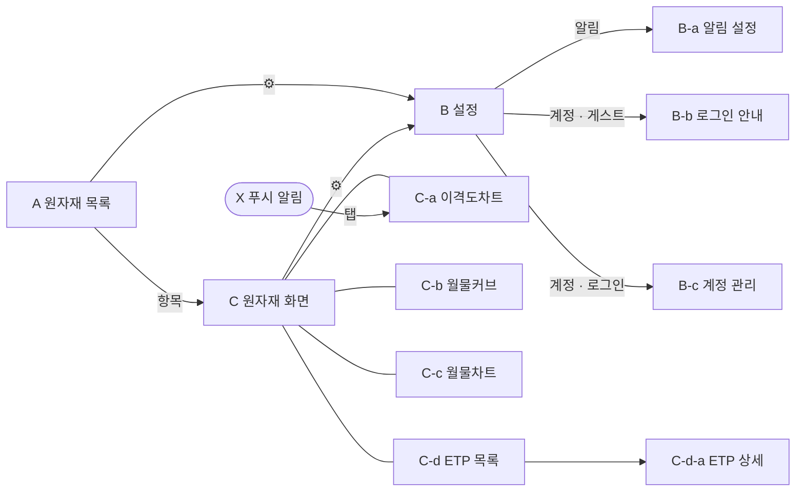

# 화면 와이어프레임 (ASCII)

> 화면 정의와 동작은 [`../product.md`](../product.md) 기준. 레이아웃 초안이며 실제 디자인은 개발 단계에서 정한다.
> 화면 ID(A, B, C …)는 문서·이슈·코드에서 화면을 가리키는 공통 이름으로 쓴다.

## 화면 목록

| ID | 화면 | 진입 | 상태 |
|---|---|---|---|
| A | 원자재 목록(홈) | 앱 실행 | 이번 정의 |
| B | 설정 | A·C title-bar ⚙ | 이번 정의 |
| B-a | 알림 설정 | B > 알림 | 현재 설계 유지, 추후 개선 |
| B-b | 로그인 안내 | 게스트가 B의 비활성 항목·계정을 누름 | 현재 설계 유지, 추후 개선 |
| B-c | 계정 관리 | B > 계정(로그인 상태) | 현재 설계 유지, 추후 개선 |
| C | 원자재 화면 | A에서 원자재 항목, X 알림 | 이번 정의 |
| C-a | 이격도차트 탭 | C 기본 탭 | 이번 정의 |
| C-b | 월물커브 탭 | C tab-bar | 이번 정의 |
| C-c | 월물차트 탭 | C tab-bar | 이번 정의 |
| C-d | ETP 목록 탭 | C tab-bar | 현재 설계 유지, 추후 개선 |
| C-d-a | ETP 상세 | C-d 항목 | 현재 설계 유지, 추후 개선 |
| X | 푸시 알림 | rare-level 도달 | 현재 설계 유지, 추후 개선 |



## 공통 규칙
- 테마: 다크 전용
- 등락 색: B 설정을 따른다. 기본 한국식(상승 빨강 / 하락 파랑), 미국식(상승 초록 / 하락 빨강)
- 가격 소수 자릿수: NG 3, CL 2, GC 1, SI 3
- 기준 시각 줄: `10/22 07:00 기준 · 지연 · 장중|휴장`. 기준 시각은 기기 현지 시간, 날짜는 CME 거래일
- 화면 방향: 세로. C-a~C-c만 가로 전환 가능(C title-bar의 [⟲] 버튼으로 수동 전환)
- 상태
  - 로딩: 스켈레톤
  - 오류: 안내 문구 + [다시 시도]
  - 휴장: 마지막 정산가와 그 시각을 표시
  - A·C는 당겨서 새로고침. 자동 새로고침 주기는 Step 2 데이터 제약 리서치 후 결정

## A. 원자재 목록(홈)
```
┌─────────────────────────────────────────────┐
│ futureETP                              [⚙]  │
│ 10/22 07:00 기준 · 지연 · 장중                │
├─────────────────────────────────────────────┤
│                NOV26   2,410.5  +12.3 +0.51%│
│  금 / GC       DEC26●  2,418.2  +12.1 +0.50%│
│                JAN27   2,425.0  +12.0 +0.50%│
│                FEB27   2,431.7  +11.9 +0.49%│
│                MAR27   2,438.1  +11.8 +0.49%│
├─────────────────────────────────────────────┤
│  은 / SI       ... (5줄)                     │
├─────────────────────────────────────────────┤
│🔔 원유 / CL    ... (5줄)                     │
├─────────────────────────────────────────────┤
│                NOV26   $2.766 -0.029 -1.04% │
│  천연가스 / NG DEC26●  $3.120 -0.031 -0.98% │
│                JAN27   $3.402 -0.025 -0.73% │
│                FEB27   $3.205 -0.020 -0.62% │
│                MAR27   $2.980 -0.018 -0.60% │
└─────────────────────────────────────────────┘
```
- 대상 원자재: 금 / 은 / 원유 / 천연가스. 원자재는 추가될 수 있으므로 목록은 데이터로 그린다.
- 항목 구성
  - 좌측: 원자재명 / 심볼
  - 우측 5줄: 월물 / 현재가 / 전일 대비 / 등락률
- 월물 5개는 최근월물부터 **만기순 연속 5개**다(거래량과 무관). 만기된 월물은 다음 거래일에 빠진다.
- `●`: 현재 대표월물
- 전일 대비는 전일 정산가 기준이다.
- 항목 사이는 padding을 넉넉히 두고 separator로 구분한다.
- 🔔: 전역 설정(B-a)에서 알림 대상으로 고른 원자재에만 붙는다.
- 항목을 누르면 C로 간다(C-a 탭).

## B. 설정
```
┌───────────────────────────────────┐
│ ←  설정                            │
├───────────────────────────────────┤
│ 계정             Guest          >  │
├─ 표시 ────────────────────────────┤
│ 언어             [한국어|English]   │
│ 등락 색          [한국식|미국식]     │
├─ 이격도차트 ───────────────────────┤
│ 차트 기준값  [대표월물|한국형|미국형] │
│ 기준 이평선(일)  [20|50|100|200]    │
│ 분포 기간(년)    [3|5|10|전체]      │
│ rare-level(%)  [5][10][15][20][25]│
│ 알림             원유           >  │
├───────────────────────────────────┤
│ 고지 · 데이터 출처 · 개인정보처리방침 > │
└───────────────────────────────────┘
```
- 설정값은 전역이다. 모든 원자재와 알림에 공통으로 쓴다.
- 계정: Guest / Apple / Google을 표시한다. 누르면 B-c로 가고, 게스트면 B-b로 간다.
- 표시 설정(언어, 등락 색)은 기기에 저장하고 게스트도 바꿀 수 있다.
  - 언어 기본값은 기기 언어, 등락 색 기본값은 한국식이다.
  - 로그인 사용자의 언어는 푸시 문구에 쓰므로 서버에도 전달한다.
- 이격도차트 설정
  - 기본값: 대표월물 / 100일 / 10년 / 5·10·15·20·25
  - rare-level은 0<p<50인 서로 다른 값 5개다.
  - 알림을 누르면 B-a로 간다.
- 게스트: 이격도차트 설정은 기본값으로 보여 주고 비활성화한다. 누르면 B-b로 간다.

## B-a. 알림 설정
> 현재 설계 유지, 추후 개선
```
┌───────────────────────────────────┐
│ ← 알림 설정                         │
├───────────────────────────────────┤
│ ⚠ 알림 권한이 꺼져 있습니다 [설정 열기]│  ← 권한 거부 시에만
│ 대상 원자재 [없음|금|은|원유●|천연가스]│
│                                   │
│ 현재 적용 기준                      │
│  기준값 미국형 · 100일선 · 10년     │
│  레벨 5/10/15/20/25 (위·아래)      │
│                                   │
│ 1시간마다 확인하며 레벨별로           │
│ CME 거래일당 1회 알려 드립니다.      │
└───────────────────────────────────┘
```

## B-b. 로그인 안내
> 현재 설계 유지, 추후 개선
```
┌───────────────────────────────────┐
│                               [✕] │
│  로그인하면                         │
│  · 차트 기준값과 rare 레벨 변경      │
│  · rare 레벨 도달 알림              │
│  · 기기 간 설정 동기화              │
│                                   │
│  [  Apple로 계속하기  ]            │
│  [  Google로 계속하기 ]            │
│                                   │
│  이메일은 저장하지 않습니다.         │
└───────────────────────────────────┘
```

## B-c. 계정 관리
> 현재 설계 유지, 추후 개선
```
┌───────────────────────────────────┐
│ ← 계정                             │
├───────────────────────────────────┤
│ 로그인 방식   Apple                 │
│                                   │
│ [로그아웃]                          │
│                                   │
│ [계정 삭제]                         │
│  설정과 알림 기록이 모두 삭제되며     │
│  되돌릴 수 없습니다.                 │
└───────────────────────────────────┘
```

## C. 원자재 화면
```
┌─────────────────────────────────────────────┐
│ [←]        천연가스 / NG         [⟲]  [⚙]   │  ← title-bar
├─────────────────────────────────────────────┤
│                                             │
│            선택한 탭의 콘텐츠                 │
│                                             │
├─────────────────────────────────────────────┤
│ [이격도차트●]  [월물커브]  [월물차트]  [ETP]  │  ← tab-bar
└─────────────────────────────────────────────┘
```
- title-bar
  - 좌측 ←: A로 돌아간다.
  - 중앙: 원자재명
  - 우측 ⚙: B로 간다(홈과 같은 설정).
  - [⟲]: 가로/세로 전환. C-a~C-c에서만 보인다.
- tab-bar 4개: 이격도차트 / 월물커브 / 월물차트 / ETP 목록. 기본은 이격도차트.
- 가로 모드
  - title-bar와 tab-bar는 높이를 줄여 유지한다.
  - ETP 탭을 누르면 세로로 돌아간다.

## C-a. 이격도차트 탭
```
┌─────────────────────────────────────────────┐
│ [←]        천연가스 / NG         [⟲]  [⚙]   │
├─────────────────────────────────────────────┤
│미국형 · 시3.090 고3.184 저2.766 종2.766      │ ← 오늘 OHLC 한 줄
│10/22 07:00 기준 · 지연 · 장중                │
│        고가 5.810(+110.1%, 01/27)↓   │       │
│─────────────────────────────────────│ 5.762 │ ← 상위 5%  (빨강)
│─────────────────────────────────────│ 5.130 │ ← 상위 10%
│ ┃       ┃┃            ...           │ 4.85  │ ← … 상위 25% (연주황)
│ ┃┃  ┃  ┃┃┃  ┃┃                      │       │
│━━━━━━━━━━━━━━━━━━━━━━━━━━━━━━━━━━━━━│ 3.401 │ ← 이평선 (굵은 노랑)
│  ┃┃┃  ┃┃   ┃┃┃┃  ┃┃┃  ┃┃┃  ┃ ┃┃     │       │
│╌╌╌╌╌╌╌╌╌╌╌╌╌╌╌╌╌╌╌╌╌╌╌╌╌╌╌╌╌╌╌╌╌╌╌╌┃│ 2.766 │ ← 현재가 (회색 점선)
│              ┃┃  ↑저가 2.410(-12.9%, 04/15)│       │
│─────────────────────────────────────│ 2.13  │ ← 하위 25% (연주황)
│ ...                                 │       │
│─────────────────────────────────────│ 1.020 │ ← 하위 5%  (빨강)
│이격도 -18.7% (하위 9%) · 저점대비 +14.8% · 고점대비 -52.4% │
│      ▲            ░░░░            ▲   │       │ ← 대표월물 전환 ▲ / 롤 기간 ░
│ 7월     10월     2026     4월     7월   10월  │ ← x축
│[3M][6M][9M][12M][2Y][4Y][6Y][8Y][10Y][전체]  │
├─────────────────────────────────────────────┤
│ [이격도차트●]  [월물커브]  [월물차트]  [ETP]  │
└─────────────────────────────────────────────┘
```
- 차트
  - 봉차트, 항상 일봉이다. 전역 기준값의 지수 봉을 그린다(한국형·미국형은 조정 가격).
  - 오늘 봉은 장중 잠정값으로 표시한다.
  - x축은 하단, y축은 우측이고 y축은 log scale이다.
  - y축 범위는 화면에 보이는 봉과 선이 모두 들어가게 바뀐다.
- 선
  - 이평선: 굵은 노랑. 노랑은 이평선 전용 색이다.
  - rare-level 선: 위 5개 + 아래 5개. 가는 선이고, 덜 드문 25%는 연주황, 가장 드문 5%는 빨강이다.
  - rare-level 선은 수평선이 아니라 이평선을 따라 움직이는 밴드다: `이평선(t) × (1 + 레벨 이격도/100)`
  - '전체' 기간의 시작 N일은 이평선과 rare-level 선이 없다.
- y축 라벨
  - 현재가(회색), 이평선, rare-level 10개의 현재 값을 표시한다. 글자색은 선 색과 같다.
  - 라벨이 겹치면 현재가에 가까운 레벨부터 표시한다. 선은 모두 그린다.
  - 현재가에는 회색 수평 점선을 함께 그린다.
- 좌상단 한 줄
  - 기준값과 오늘의 시가 / 고가 / 저가 / 종가를 표시한다.
  - 기준값이 없는 원자재라 대표월물로 대신 보여 주면 `대표월물*`로 표기한다.
  - 기준값을 누르면 조정 가격 안내와 대체 안내 툴팁이 나온다.
- 좌하단 한 줄: 이격도(현재 백분위) · 저점대비(LC) · 고점대비(HC). 영어 UI는 `LC` / `HC`로 표기한다.
  - 저점대비(LC) = `현재가 / 보이는 구간 최저가 − 1`
  - 고점대비(HC) = `현재가 / 보이는 구간 최고가 − 1`
- 고가·저가 꼬리표: 보이는 봉 중 최고가와 최저가 봉에 `가격(현재가 대비 %, 날짜)`로 붙인다.
- 롤 표시
  - 대표월물 기준이면 전환일에 x축 위 ▲ 마커를 표시한다.
  - 한국형·미국형 기준이면 롤 기간을 옅은 음영 ░로 표시한다.
- 기간과 제스처
  - 기간 버튼 10개는 폭을 10등분한 한 줄에 두고, 높이 44pt로 터치 영역을 확보한다. 최초 선택은 12M이고, 마지막으로 누른 버튼을 기기에 기억한다.
  - 핀치로 확대·축소하고 드래그로 이동한다. 제스처로 범위를 바꾸면 기간 버튼의 선택 표시가 해제된다.
  - 축소는 '전체'까지, 이동은 데이터 시작부터 오늘까지 가능하다.
  - y축 범위, 꼬리표, 저점대비·고점대비는 보이는 봉 기준으로 바로 갱신한다.

### C-a 길게 누르기(십자선)
```
│            ┊                                │
│ ┌────────────────────────┐  ┊               │
│ │ 2026-10-01              │  ┊               │
│ │ 시 2.912  고 2.950       │  ┊               │
│ │ 저 2.840  종 2.850       │  ┊               │
│ │ 전일 대비 -0.049 (-1.69%)│  ┊               │
│ │ 이격도 -14.2%            │  ┊               │
│ │ 롤 중: NOV26→DEC26 40%   │  ┊               │
│ └────────────────────────┘  ┊               │
│┄┄┄┄┄┄┄┄┄┄┄┄┄┄┄┄┄┄┄┄┄┄┄┄┄┄┄┄┄┼┄┄┄┄┄┄┄│[2.850]│
│                      [2026-10-01]           │
```
- 길게 누르면 십자선이 나타나고, x축에 날짜 라벨, y축에 가격 라벨이 붙는다.
- 십자선이 나온 상태에서 드래그하면 십자선이 움직인다. 봉에 붙을 때마다 햅틱 피드백을 준다.
- 상세 박스는 손가락 반대편에 놓는다.
- 박스 내용: 날짜, 시가·고가·저가·종가, 전일 대비, 이격도. 롤 중이면 롤 비중도 보여 준다.
- 좌상단 줄은 바뀌지 않고 계속 오늘 값을 보여 준다.
- 빈 곳을 한 번 더 누르면 십자선이 사라진다.

### C-a 가로 모드
```
┌──────────────────────────────────────────────────────────────────────┐
│ [←]  천연가스 / NG                                       [⟲]  [⚙]    │
├──────────────────────────────────────────────────────────────────────┤
│미국형 · 시3.090 고3.184 저2.766 종2.766 · 10/22 07:00 기준 · 지연 · 장중 │
│                    (세로와 같은 차트, 가로로 넓게)              │ y축  │
│이격도 -18.7% (하위 9%) · 저점대비 +14.8% · 고점대비 -52.4%      │      │
│[3M][6M][9M][12M][2Y][4Y][6Y][8Y][10Y][전체]                          │
├──────────────────────────────────────────────────────────────────────┤
│ [이격도차트●]  [월물커브]  [월물차트]  [ETP]                            │
└──────────────────────────────────────────────────────────────────────┘
```

## C-b. 월물커브 탭
```
┌─────────────────────────────────────────────┐
│ [←]        천연가스 / NG         [⟲]  [⚙]   │
├─────────────────────────────────────────────┤
│ ╌╌ 기준일 10/21 종가   ── 현재 10/22         │
│ 10/22 07:00 기준 · 지연 · 장중                │
│ $                                           │
│ 3.5 ┤          -0.7%  -0.6%                 │
│     │      ●───●───●╌╌╌○                    │
│ 3.1 ┤  ●───○╌╌╌○   ╰───●───○                │
│     │ ╱ -1.0%                               │
│ 2.7 ┤●  -1.0%                               │
│     └─NOV26─DEC26─JAN27─FEB27─MAR27─APR27─  │
│                                             │
│   [ - ]     10/21 (D-1)     [ + ]    [ 0 ]  │
│ 콘탱고 · DEC26→JAN27 +9.0%                   │
│ 롤 수익률 -97.6%/년 (기준일 -95.1%/년)        │
├─────────────────────────────────────────────┤
│ [이격도차트]  [월물커브●]  [월물차트]  [ETP]  │
└─────────────────────────────────────────────┘
```
- 목적: 기준일 종가에 비해 현재가가 어떻게 변했는지 커브 전체로 본다.
- 선차트
  - 기준일 종가는 점선, 현재가는 실선이다.
  - 각 점에 변화율을 붙인다. 색은 등락 색 설정을 따른다.
  - 점을 누르면 툴팁(월물 / 기준일 / 현재 / 변화율)이 나온다.
- 축
  - x축은 실제 월물(만기순)이고, 거래량 기준 미달 월물은 뺀다.
  - 기준일에만 있던 월물(그 사이 만기된 월물)은 기준일 선에만 표시한다.
  - y축은 가격이다.
- 날짜 기준
  - D = 최근 CME 거래일. 장중에는 최근 스냅숏, 장 마감 뒤에는 정산가를 쓴다.
  - 기준일 기본값은 D의 직전 거래일(D-1)이다.
- 버튼
  - `-`: 기준일을 1 거래일 앞으로
  - `+`: 기준일을 1 거래일 뒤로. D-1이 상한이다.
  - `0`: 기준일을 D-1로 되돌린다.
  - 범위 끝에서는 해당 버튼을 비활성화한다. 하한은 데이터 보관 범위이고 Step 2에서 정한다.
- 수치 요약
  - 커브 상태(콘탱고/백워데이션), M1→M2 스프레드, 연환산 롤 수익률. M1은 대표월물이다.
  - 롤 수익률은 기준일 값도 함께 보여 준다.
- 전역 설정은 쓰지 않는다(등락 색 제외).

## C-c. 월물차트 탭
```
┌─────────────────────────────────────────────┐
│ [←]        천연가스 / NG         [⟲]  [⚙]   │
├─────────────────────────────────────────────┤
│ 10/22 07:00 기준 · 지연 · 장중                │
│ $                                    │       │
│                         ╭──╮  ╭───── │ 3.402 JAN27
│              ╭─────────╯   ╰─╯ ╭──── │ 3.205 FEB27
│         ╭───╯  ╭──────────────╯ ╭─── │ 3.120 DEC26
│ ───────╯ ╭────╯ ╭──────────────╯ ╭── │ 2.980 MAR27
│ ────────╯ ─────╯                ╰─── │ 2.766 NOV26
│ 11월     1월     3월     5월     7월   10월│
│[3M][6M][9M][12M][2Y][4Y][6Y][8Y][10Y][전체]  │
├─────────────────────────────────────────────┤
│ [이격도차트]  [월물커브]  [월물차트●]  [ETP]  │
└─────────────────────────────────────────────┘
```
- 선차트로 A와 같은 월물 5개(만기순 연속)를 한 번에 겹쳐 그린다. 월물마다 독립된 원가격 선이다.
- 각 선은 그 월물의 상장일부터 오늘까지다. 기간 안에서 상장일 이전 구간은 그리지 않는다.
- x축
  - 날짜를 공유하고 오른쪽 끝이 오늘이다.
  - 기간 버튼과 제스처는 C-a와 같다. '전체'는 가장 긴 월물의 상장일부터다.
  - 기간 선택은 C-a와 따로 기억하고, 최초는 12M이다.
- y축은 선형이고, 5개 선이 모두 보이게 범위가 바뀐다.
- 각 선의 끝값을 y축에 선 색으로 표시하며, 이 라벨이 범례를 대신한다.
- 전역 설정은 쓰지 않는다.

## C-d. ETP 목록 탭
> 현재 설계 유지, 추후 개선. C 화면의 탭이므로 title-bar는 C의 것을 쓰고, 원자재 필터 기본값은 현재 원자재다.
```
┌───────────────────────────────────┐
│ 원자재 [천연가스 ▾]  시장 [전체 ▾]  │
│ 유형 [ETF|ETN]  배수 [전체 ▾]       │
│ 환헤지 [전체 ▾]                     │
├───────────────────────────────────┤
│ KODEX 천연가스선물(H)              │
│  KRX · ETF · 1x · 환헤지        >  │
│ ───────────────────────────────── │
│ UNG  United States Natural Gas    │
│  US · ETF · 1x · 해당 없음      >  │
│ ───────────────────────────────── │
│ ○○ 레버리지 천연가스 선물 ETN       │
│  KRX · ETN · 2x · 환노출        >  │
├───────────────────────────────────┤
│ [이격도차트] [월물커브] [월물차트] [ETP●]│
└───────────────────────────────────┘
```

## C-d-a. ETP 상세
> 현재 설계 유지, 추후 개선
```
┌───────────────────────────────────┐
│ ← KODEX WTI원유선물(H)             │
├───────────────────────────────────┤
│ 원자재    WTI 원유                  │
│ 상장시장  KRX   유형  ETF   배수 1x │
│ 환헤지    O                         │
│ 운용사    ○○자산운용                │
│ 기초지수  ○○ WTI Crude Oil ER      │
│ 총보수    0.xx%                     │
│ 상장일    20xx-xx-xx                │
│                                   │
│ [운용사 페이지 열기 ↗]              │
│ (자동 수집 정보 · 원문 언어로 표시)  │
└───────────────────────────────────┘
```

## X. 푸시 알림
> 현재 설계 유지, 추후 개선
```
┌───────────────────────────────────┐
│ futureETP                    지금  │
│ 원유(미국형) 이격도 상위 5% 도달     │
│ 현재 +18.6% · 100일선 · 09:00 기준 │
└───────────────────────────────────┘
```
- 누르면 해당 원자재의 C 화면(C-a 탭)으로 간다. 알림의 이격도 값은 C-a 좌하단 줄에서 다시 확인할 수 있다.
